# Oracle 事务兼容方案（讨论稿）

- 日期：2026-11-12
- 范围：`ivorysql.compatible_mode = oracle` 下的显式事务、PL/iSQL 事务、保存点、异常处理
- 目标：兼容到“未处理异常只回滚失败语句、事务保持可用”，而不是“未处理异常回滚整个 PL/SQL 调用”

---

## 1. 最终目标

### 1.1 必须满足的 Oracle 行为

1. 显式事务中某条语句失败：
   - 只回滚失败语句；
   - 事务保持可用；
   - 后续语句可以继续执行，最后可以正常 `COMMIT`。

2. PL/iSQL 块内某条语句失败：
   - 如果被 `EXCEPTION` 捕获：
     - 只回滚失败语句；
     - 块内之前成功的语句保留；
     - 继续执行 handler。
   - 如果未被捕获：
     - 仍然只回滚失败语句；
     - 子程序/块内之前成功的修改不被回滚；
     - 事务保持可用；
     - 错误返回给客户端。

3. `SAVEPOINT` / `ROLLBACK TO SAVEPOINT`：
   - 用户 savepoint 是事务作用域的；
   - `ROLLBACK TO` 回滚到目标 savepoint，但保留目标 savepoint；
   - 目标之后创建的 savepoint 失效；
   - 回滚后事务继续可用。

4. `COMMIT` / `ROLLBACK`：
   - 在带 `EXCEPTION` 的块内部可用；
   - 在嵌套块中可用；
   - 在显式事务块中的 `CALL` / `DO` 内可用；
   - `COMMIT` 结束当前事务及所有 savepoint；
   - `ROLLBACK` 回滚当前事务及所有 savepoint。

5. 自治事务：
   - 保持现有宽松策略即可，退出时未显式提交可以自动提交；
   - 但自治事务内部也应复用同一套语句级事务帧模型；
   - 自治事务与主事务的 savepoint 作用域互相隔离。

### 1.2 明确不追求

- 不在本期实现 Oracle undo/回滚段机制。
- 不要求 `COMMIT WRITE BATCH NOWAIT` 等 LGWR 细节行为完全一致。
- 不要求分布式事务 `COMMIT FORCE` / `ROLLBACK FORCE` 的完整语义。
- 自治事务退出时是否严格报 `ORA-06519` 暂不强制，保持当前宽松行为即可。

---

## 2. 当前仓库现状

### 2.1 已有能力

1. 兼容模式：
   - `src/include/utils/ora_compatible.h:32`
   - `PG_MODE` / `ORA_MODE` / `MYS_MODE`

2. 语句级回滚 GUC：
   - `ivorysql.ora_statement_level_rollback`
   - `src/backend/utils/misc/ivy_oracle_guc.c:1015`
   - 默认 `false`

3. 自动 savepoint：
   - `SetAutoSavepoint`：`src/backend/access/transam/xact.c:6694`
   - `RollbackToAutoSavepoint`：`src/backend/access/transam/xact.c:6722`
   - SQL 主循环设置：`src/backend/tcop/postgres.c:5856`
   - 顶层错误处理回滚：`src/backend/tcop/postgres.c:5113`

4. PL/iSQL 的 `COMMIT` / `ROLLBACK`：
   - 语法：`src/pl/plisql/src/pl_gram.y:4197`、`:4212`
   - 执行：`src/pl/plisql/src/pl_exec.c:6917`、`:6964`

5. PL/iSQL 异常块：
   - 块入口开启子事务：`src/pl/plisql/src/pl_exec.c:2394`
   - 异常时按语句 savepoint 回滚：`src/pl/plisql/src/pl_exec.c:2471`
   - 每条语句成功后设置 savepoint：`src/pl/plisql/src/pl_exec.c:2993`

6. 自治事务：
   - `BeginInternalAutonTransaction`：`src/backend/access/transam/xact.c:7635`
   - `ReleaseCurrentAutonTransaction`：`:7700`
   - `RollbackAndReleaseCurrentAutonTransaction`：`:7728`
   - PL/iSQL 入口：`src/pl/plisql/src/pl_handler.c:410`
   - 退出释放：`src/pl/plisql/src/pl_handler.c:524`

### 2.2 当前主要问题

1. **带异常块的 PL/iSQL 不能正常 COMMIT/ROLLBACK**
   - 异常块入口 `BeginInternalSubTransaction(NULL)` 创建了块级子事务。
   - PG 的 SPI 禁止在子事务中提交/回滚：
     - `src/backend/executor/spi.c:274`
     - `src/backend/executor/spi.c:370`
   - 现有测试明确记录该错误：
     - `src/pl/plisql/src/expected/plisql_autonomous_transaction.out:2621`
     - `src/pl/plisql/src/expected/plisql_autonomous_transaction.out:3294`

2. **显式事务块里的 CALL / DO 被强制 atomic**
   - `src/backend/tcop/utility.c:661`：
     `isAtomicContext = ... || IsTransactionBlock()`
   - 导致显式事务中调用过程、过程内 `COMMIT` 报 `invalid transaction termination`。

3. **当前语句级 savepoint 会覆盖用户 savepoint**
   - `SetAutoSavepoint` 按名字搜索目标 savepoint，并 release 当前到目标之间的所有子事务。
   - 如果用户在中间创建了 `SAVEPOINT x`，下一次自动 savepoint 会把 `x` 一起 release。

4. **当前语句级回滚是 GUC 控制且默认关闭**
   - 默认仍是 PG 行为：出错后整个事务 aborted。

5. **当前异常处理是块级回滚**
   - 有异常块时，默认回滚整个块，而不是只回滚失败语句。
   - 未处理异常时，也没有实现“保留子程序之前成功修改、事务保持可用”的 Oracle 语义。

6. **PL/iSQL 缺少静态事务语法**
   - 没有 `SAVEPOINT`；
   - 没有 `ROLLBACK TO [SAVEPOINT]`；
   - 没有 Oracle 风格 `COMMIT` / `ROLLBACK` 选项；
   - 动态 SQL 执行事务语句也明确不支持：
     - `src/pl/plisql/src/pl_exec.c:6255`

---

## 3. 核心设计：事务作用域帧栈

### 3.0 会话事务模型：已选方案 B（默认 `ora_autocommit=on`）

**决策：ORA 模式支持 Oracle 隐式事务模型，但默认通过 `ivorysql.ora_autocommit=on` 模拟客户端 autocommit on。**

- 默认 `ivorysql.ora_autocommit=on`：
  - 顶层命令结束提交；
  - 兼容常见客户端/连接池默认 autocommit on 的预期；
  - PL/iSQL 内部 `COMMIT` 后剩余语句进入新事务，并在顶层命令结束时提交。
- `ivorysql.ora_autocommit=off`：
  - 采用严格 Oracle 隐式事务连续性；
  - 第一条可执行 SQL 隐式开启事务；
  - 语句执行完后事务保持打开，不自动提交；
  - `COMMIT` / `ROLLBACK` 结束当前事务；
  - 下一条可执行 SQL 自动开启新事务。

当 `ora_autocommit=off` 时，行为约定：

- `SAVEPOINT` / `ROLLBACK TO` 在没有 `BEGIN` 时也可用；
- `COMMIT` / `ROLLBACK` 在无事务时静默成功，不再输出 PG WARNING；
- `BEGIN` / `START TRANSACTION` 作为兼容扩展接受；
- 断开连接时由 `ivorysql.ora_commit_before_disconnect` 决定提交还是回滚。

建议实现方式：

- `ora_autocommit=off` 时，ORA 模式下 `start_xact_command` 首次启动事务后，把事务状态置为 `TBLOCK_INPROGRESS`，或新增 `TBLOCK_ORA_IMPLICIT_INPROGRESS`；
- `finish_xact_command` 在 `off` 时不自动提交，只做 `CommandCounterIncrement`；
- `COMMIT` / `ROLLBACK` 后回到 `TBLOCK_DEFAULT`，下一条语句再隐式开启新事务；
- `on` 时沿用“顶层命令结束提交”的模型；
- 不能沿用 `TBLOCK_IMPLICIT_INPROGRESS` 原有“COMMIT 时告警”的行为；
- 需要一个 session flag 区分“ORA 隐式事务”和“PG 显式事务块”。

#### 3.0.1 已定子项

1. **新增 `ivorysql.ora_autocommit`**
   - 默认 `true`；
   - `PGC_USERSET`，仅 ORA 模式生效；
   - `true`：服务端模拟客户端 autocommit on，顶层命令结束后提交；
   - `false`：严格 Oracle 隐式事务，语句结束不提交。

2. **所有可执行 SQL 都作为事务执行单元**
   - 包括 `SELECT`、DML、DDL、`SELECT FOR UPDATE`、`LOCK`、`SET TRANSACTION`、`SAVEPOINT`、`CALL` / `DO`；
   - `off`：开启隐式事务并保持打开；
   - `on`：开启事务，顶层命令结束提交；
   - 阶段 1 先按严格模型验证 `off`，`on` 作为默认行为；
   - 后续根据连接池和 `idle in transaction` 的实际情况，再评估是否对纯 `SELECT` 做例外优化。

3. **多语句 simple Query 的处理分阶段**
   - 阶段 1：
     - 事务保持打开；
     - 某条语句失败时，只回滚失败语句；
     - 中止当前 Query 消息的后续语句；
     - 错误返回客户端，事务保持可用。
   - 阶段 2：
     - 实现 Oracle 风格“只回滚失败语句并继续执行同一消息中的后续语句”。

4. **`idle_in_transaction_session_timeout`**
   - 用户显式设置仍然生效，不静默忽略；
   - 默认值为 0 时不启用；
   - 文档说明 ORA 隐式事务可能长期处于 idle in transaction，用户可自行配置该超时；
   - 后续如需 ORA 专用控制，再增加独立参数。

5. **`BEGIN` / `START TRANSACTION` / `AND CHAIN`**
   - `BEGIN` / `START TRANSACTION` 作为兼容扩展接受，等价于确保事务已开启；
   - **显式 `BEGIN` 后暂停 `ora_autocommit=on` 的自动提交**，直到 `COMMIT` / `ROLLBACK`；
   - 显式事务块内的 `SAVEPOINT` / `ROLLBACK TO` 跨语句有效；
   - `COMMIT AND CHAIN` / `ROLLBACK AND CHAIN` 等价为 `COMMIT` / `ROLLBACK`，因为方案 B 下提交/回滚后本来就会在下一条语句隐式开启新事务；
   - 无事务时 `COMMIT` / `ROLLBACK` 静默成功，不输出 PG WARNING。

#### 3.0.2 方案 B 行为矩阵

| 场景 | `ora_autocommit=on`（默认，模拟客户端 autocommit） | `ora_autocommit=off`（严格 Oracle 隐式事务） |
|---|---|---|
| 连接后第一条可执行 SQL | 开启事务，命令结束提交 | 隐式开启事务并保持打开 |
| 普通 `SELECT` | 命令结束提交 | 开启并保持事务 |
| 普通 DML | 命令结束提交 | 开启并保持事务 |
| 普通语句结束 | 提交 | 不提交 |
| `COMMIT` | 结束事务 | 结束事务 |
| `ROLLBACK` | 回滚并结束事务 | 回滚并结束事务 |
| 无事务时 `COMMIT` / `ROLLBACK` | 静默成功 | 静默成功 |
| `SAVEPOINT` 无 `BEGIN` | 允许，但语句结束即提交，savepoint 不跨语句 | 允许，事务保持打开 |
| `ROLLBACK TO SAVEPOINT` | 仅当前语句内有效 | 允许，目标 savepoint 保留 |
| `BEGIN` / `START TRANSACTION` | 兼容接受，并暂停自动提交 | 兼容接受，确保事务开启 |
| 显式 `BEGIN` 后的语句 | 不逐语句提交，直到 `COMMIT` / `ROLLBACK` | 不逐语句提交，直到 `COMMIT` / `ROLLBACK` |
| 显式事务块内 `SAVEPOINT` / `ROLLBACK TO` | 跨语句有效 | 跨语句有效 |
| `COMMIT AND CHAIN` | 等价 `COMMIT` | 等价 `COMMIT` |
| PL/iSQL 内部 `COMMIT` | 提交后进入新事务，顶层命令结束再提交 | 提交后进入新事务并保持打开 |
| PL/iSQL 内部 `ROLLBACK` | 回滚后进入新事务，顶层命令结束再提交 | 回滚后进入新事务并保持打开 |
| 顶层命令失败（`on`） | 回滚失败语句，保留之前成功的工作，事务保持打开；不触发自动提交 | — |
| 多语句 Query 中某条失败 | 阶段 1：回滚失败语句，中止后续语句，事务保持打开 | 阶段 1：回滚失败语句，中止后续语句，事务可用 |
| 连接断开 | 由 `ora_commit_before_disconnect` 决定 | 由 `ora_commit_before_disconnect` 决定 |

> 说明：
>
> - 默认 `ora_autocommit=on`，用于兼容常见客户端/连接池默认 autocommit on 的预期。
> - 显式 `BEGIN` / `START TRANSACTION` 会暂停自动提交，直到 `COMMIT` / `ROLLBACK`。
> - `on` 模式下只有“成功完成的顶层命令”才触发自动提交；失败命令不回滚失败语句之前已经成功的工作，事务保持打开。
> - 多语句 simple Query 阶段 1 采用“每条内部语句独立 autocommit 单元”的目标语义；如果阶段 1 实现不了，则明确退化为“整个消息一个提交单元”并标注限制。
> - 多语句 simple Query 的逐语句继续执行属于阶段 2 的工作。

### 3.1 为什么仍然需要子事务

PostgreSQL 中唯一的“部分回滚”机制就是子事务：

- `DefineSavepoint` / `BeginInternalSubTransaction`
- 最终都走 `PushTransaction`
- 回滚通过 `AbortSubTransaction` / `CleanupSubTransaction` 完成

因此，要兼容 Oracle 的语句级原子性，子事务仍然存在，只是粒度改变：

- 去掉“异常块级子事务”；
- 引入“语句级内部子事务”；
- 用户 `SAVEPOINT` 明确作为用户子事务管理。

### 3.2 帧栈模型

建议引入事务作用域的事务帧栈：

```text
主事务 root
  ├── 语句帧（内部）
  ├── 用户 savepoint 帧
  ├── 自治事务 root
  │     ├── 语句帧（内部）
  │     └── 用户 savepoint 帧
  └── ...
```

帧类型：

```c
typedef enum PLiSQL_txframe_kind
{
    PLISQL_TXFRAME_STATEMENT,       /* 内部语句 savepoint */
    PLISQL_TXFRAME_USER_SAVEPOINT,  /* 用户 SAVEPOINT */
    PLISQL_TXFRAME_AUTON_ROOT,      /* 自治事务边界 */
    PLISQL_TXFRAME_BLOCK_LOGICAL    /* 异常块逻辑帧，不是子事务 */
} PLiSQL_txframe_kind;
```

帧结构建议：

```c
typedef struct PLiSQL_tx_frame
{
    struct PLiSQL_tx_frame *parent;
    PLiSQL_txframe_kind     kind;
    char                   *name;
    SubTransactionId        subxid;
    bool                    subxact_alive;
    bool                    has_handler;
    bool                    in_handler;
} PLiSQL_tx_frame;
```

关键原则：

1. 事务帧栈必须是**事务作用域**，不能只放在单个 `PLiSQL_execstate` 中。
   - 同一个事务内不同过程调用要共享用户 savepoint。
   - 建议挂在 `TransactionStateData` 或通过全局当前事务帧指针管理。

2. 内部语句帧和用户 savepoint 帧严格分离。
   - 内部逻辑不能按名字搜索后把用户 savepoint 一起 release。

3. 自治事务拥有自己的帧栈 root。
   - 自治事务内的 `COMMIT` / `ROLLBACK` 只处理自治事务 root 下的帧。
   - 不能回滚到主事务的 savepoint，主事务也不能回滚到自治事务的 savepoint。

### 3.3 语句帧的生命周期

严格 Oracle 模式下：

```text
执行语句前：
  create statement frame
  BeginInternalSubTransaction(NULL)

语句成功：
  ReleaseCurrentSubTransaction()
  pop statement frame

语句失败：
  回滚该语句 frame
  如果有 handler：执行 handler
  如果没有 handler：错误向上传播，事务保持可用
```

语句帧创建范围（严格模式）：

- `EXECSQL`
- `SELECT ... INTO`
- `DYNEXECUTE`
- `CALL`
- `FORALL`（整个 `FORALL` 一个帧，不能按迭代创建）
- 其他实际执行 SQL、可能修改数据的语句

不需要创建语句帧：

- 简单变量赋值
- `IF` / `CASE` / `LOOP` 等控制结构本身
- 纯控制流语句

这样可以避免无意义的子事务开销。

### 3.4 异常块模型

去掉块级子事务，改为逻辑帧：

```text
进入带 EXCEPTION 的块：
  push BLOCK_LOGICAL frame（has_handler = true）

执行块体：
  每条 SQL 语句在需要时创建 STATEMENT frame

语句失败：
  找到最近的、条件匹配的 handler
  如果当前块有 handler：
    回滚失败语句 frame
    执行 handler（in_handler = true）
  否则：
    继续向上传播

块正常结束：
  pop BLOCK_LOGICAL frame
```

重点：

- handler 只捕获当前块体中的异常；
- handler 自身抛出的异常不再被同一个块捕获；
- 外层块仍然可以捕获 handler 抛出的异常；
- handler 中的 SQL 语句同样需要语句帧，以便外层 handler 捕获时只回滚失败语句。

### 3.5 未处理异常与顶层错误处理

这是严格兼容的关键。

Oracle 文档明确：

> If a stored subprogram exits with an unhandled exception, PL/SQL does not roll back database changes made by the subprogram.

因此：

- 未处理异常不能回滚整个 PL/SQL 调用；
- 只能回滚失败语句；
- 事务要保持可用。

需要改造顶层错误处理：

1. 错误发生时，如果当前存在 PL/iSQL 语句帧：
   - 不直接 `AbortCurrentTransaction()`；
   - 改为回滚失败语句帧；
   - 保留外层事务状态；
   - 再向客户端报错。

2. 如果不存在语句帧：
   - 保持现有 PG 错误恢复逻辑。

3. 错误返回后：
   - 事务状态应回到失败语句执行前；
   - 后续语句可以继续执行；
   - 最终可以正常 `COMMIT`。

这块需要单独设计，涉及：

- `PostgresMain` 错误处理路径；
- `AbortCurrentTransaction` 的替代恢复逻辑；
- `PortalErrorCleanup` / `FlushErrorState` / snapshot / memory context 清理；
- `ReadyForQuery` 状态。

---

## 4. COMMIT / ROLLBACK 设计

### 4.1 普通事务 COMMIT

```text
1. 摊平当前事务 root 下的所有内部语句帧；
2. 用户 savepoint 全部结束；
3. 把顶层 TBLOCK_STARTED 提升为 TBLOCK_INPROGRESS（自动提交场景）；
4. EndTransactionBlock(chain);
5. CommitTransactionCommand();
6. StartTransactionCommand();
7. 重置事务帧栈，后续语句重新建帧。
```

### 4.2 普通事务 ROLLBACK

```text
1. 回滚当前事务 root 下的所有内部语句帧；
2. 用户 savepoint 全部回滚；
3. UserAbortTransactionBlock(chain);
4. CommitTransactionCommand();
5. StartTransactionCommand();
6. 重置事务帧栈。
```

### 4.3 ROLLBACK TO SAVEPOINT

```text
1. 在当前事务作用域内查找用户 savepoint；
2. 回滚目标 savepoint 之上的所有内部语句帧；
3. RollbackToSavepoint(name);
4. CommitTransactionCommand();
5. 目标 savepoint 保留并 restart；
6. 后续语句继续在目标 savepoint 下建语句帧。
```

注意：

- 目标之后的用户 savepoint 失效；
- 目标 savepoint 本身保留；
- 自治事务不能回滚到主事务 savepoint，反之亦然。

### 4.4 自治事务 COMMIT / ROLLBACK

自治事务保持独立事务边界：

```text
1. 只处理当前自治事务 root 下的帧；
2. 摊平/回滚后，走现有自治事务提交/回滚路径；
3. 不触碰主事务帧；
4. 新自治事务开始后重建自治事务帧栈 root。
```

现有代码参考：

- `src/backend/access/transam/xact.c:7700` `ReleaseCurrentAutonTransaction`
- `src/backend/access/transam/xact.c:7728` `RollbackAndReleaseCurrentAutonTransaction`

自治事务退出仍保持当前宽松策略：未显式提交时自动提交。

---

## 5. 语法与 AST 设计

### 5.1 PL/iSQL 新增语句

建议统一成一个事务语句节点：

```c
typedef enum PLiSQL_txn_stmt_kind
{
    PLISQL_TXN_COMMIT,
    PLISQL_TXN_ROLLBACK,
    PLISQL_TXN_SAVEPOINT,
    PLISQL_TXN_ROLLBACK_TO,
    PLISQL_TXN_SET_TRANSACTION
} PLiSQL_txn_stmt_kind;

typedef struct PLiSQL_stmt_txn
{
    PLiSQL_stmt_type       cmd_type;
    int                    lineno;
    unsigned int           stmtid;
    PLiSQL_txn_stmt_kind   kind;
    char                  *savepoint_name;
    bool                   chain;
    char                  *comment;
    int                    write_mode;
    bool                   nowait;
    char                  *force_gid;
    List                  *set_options;
} PLiSQL_stmt_txn;
```

需要修改：

- `src/pl/plisql/src/plisql.h`
- `src/pl/plisql/src/pl_gram.y`
- `src/pl/plisql/src/pl_exec.c`
- `src/pl/plisql/src/pl_funcs.c`
- `src/pl/plisql/src/pl_unreserved_kwlist.h`

`pl_funcs.c` 中需要同步：

- `plisql_stmt_type_name`
- `free_stmt`
- `dump_stmt`

位置参考现有 commit/rollback：

- `src/pl/plisql/src/pl_funcs.c:428`
- `src/pl/plisql/src/pl_funcs.c:610`
- `src/pl/plisql/src/pl_funcs.c:1190`

### 5.2 关键字

建议按 unreserved 增加：

- `savepoint`
- `work`
- `comment`
- `write`
- `wait`
- `nowait`
- `batch`
- `force`
- `set`
- `transaction`

### 5.3 Oracle 语法映射

| Oracle 语法 | 处理建议 |
|---|---|
| `SAVEPOINT name;` | 创建用户事务帧 |
| `ROLLBACK TO name;` | 回滚到用户 savepoint，保留目标 |
| `COMMIT;` | 提交当前事务 |
| `ROLLBACK;` | 回滚当前事务 |
| `COMMIT WORK;` | 同 `COMMIT` |
| `COMMIT COMMENT 'txt';` | 接受并忽略注释 |
| `COMMIT WRITE IMMEDIATE WAIT;` | 接受并忽略 |
| `COMMIT WRITE BATCH NOWAIT;` | 接受，必要时提示不支持或忽略 |
| `COMMIT FORCE 'gid';` | 建议暂报不支持，或映射普通 COMMIT |
| `ROLLBACK FORCE 'gid';` | 建议暂报不支持，或映射普通 ROLLBACK |
| `SET TRANSACTION READ ONLY;` | ORA 模式可映射为 `REPEATABLE READ + READ ONLY` |
| `SET TRANSACTION ISOLATION LEVEL SERIALIZABLE;` | 语义与 PG SSI 不同，需要单独评估 |

### 5.4 SQL 层事务语法

如果需要同时补齐 SQL 层：

- 扩展 `TransactionStmt` 节点；
- 修改 `copyfuncs.c` / `equalfuncs.c` / `outfuncs.c` / `readfuncs.c`；
- 修改 `src/backend/oracle_parser/ora_gram.y:15054` 的 `TransactionStmt`。

---

## 6. 显式事务块中的 CALL / DO

需要修改 `isAtomicContext` 计算：

- ORA 模式下，`CALL procedure` 应该允许提交；
- 顶层 `DO` / 匿名 PL/SQL 块应该允许提交；
- 函数、触发器仍然保持 atomic。

参考位置：

- `src/backend/tcop/utility.c:661`
- `src/backend/commands/functioncmds.c:3785` `ExecuteCallStmt`
- `src/pl/plisql/src/pl_handler.c:351` `nonatomic` 判定

需要保留 package SECURITY DEFINER 等已有特殊判断。

---

## 7. 性能模型

严格模式会为每条可能失败的 SQL 语句创建子事务，成本不可忽略：

- `TransactionState` 分配
- `SubTransactionId` 分配
- ResourceOwner / MemoryContext / GUC nesting
- `pg_subtrans` 记录
- 锁和快照的 subcommit 处理

控制策略：

1. 只对可能修改数据或需要原子回滚的语句创建语句帧；
2. 控制流语句本身不创建；
3. `FORALL` 整体一个帧；
4. 提供 GUC 退路：
   - `ivorysql.ora_statement_level_rollback = on`：严格 Oracle 语义；
   - `off`：性能优先，未处理异常回滚整个 PL/SQL 调用。

建议 ORA 模式下默认采用严格语义。

---

## 8. 分阶段落地计划

### 阶段 1：语法 + 基础事务帧

- 新增 PL/iSQL 事务语句节点；
- 增加 `SAVEPOINT`、`ROLLBACK TO`、Oracle 风格 `COMMIT` / `ROLLBACK` 语法；
- 引入事务帧栈；
- 修复 `isAtomicContext`，显式事务块中的 `CALL` / `DO` 可以 `COMMIT`；
- 新增允许嵌套子事务提交/回滚的内部 API。

验收：

```sql
BEGIN;
CALL p_commit;
COMMIT;

BEGIN
  INSERT ...;
  SAVEPOINT s1;
  INSERT ...;
  ROLLBACK TO s1;
  COMMIT;
END;
/
```

### 阶段 2：异常处理语句级化

- 去掉异常块级子事务；
- 严格模式下为所有可能失败的 SQL 语句创建语句帧；
- 异常时只回滚失败语句；
- 用户 savepoint 与内部帧解耦；
- 未处理异常保留子程序之前成功修改，事务保持可用；
- 改造顶层错误处理。

验收：

```sql
BEGIN
  INSERT INTO t VALUES (1);
  INSERT INTO t VALUES ('bad');
  INSERT INTO t VALUES (2);
EXCEPTION
  WHEN OTHERS THEN
    INSERT INTO t VALUES (3);
    COMMIT;
END;
/
-- Oracle 期望：1、3 保留，2 不执行

BEGIN
  INSERT INTO t VALUES (1);
  INSERT INTO t VALUES ('bad');
END;
/
-- Oracle 期望：1 保留，事务仍可用，可以继续执行并 COMMIT
```

### 阶段 3：自治事务统一

- 自治事务内部复用同一套语句帧模型；
- 引入自治事务帧栈 root；
- 修复自治事务内 `EXCEPTION` + `COMMIT` 问题；
- 保持自治事务退出宽松策略。

### 阶段 4：SQL 层事务语法与隔离级别

- `COMMIT COMMENT` / `COMMIT WRITE` / `COMMIT FORCE`
- `ROLLBACK FORCE`
- `SET TRANSACTION` Oracle 选项
- `READ ONLY` 快照语义
- 视需求决定是否做 DDL 隐式提交

### 阶段 5：回归测试与性能优化

- 更新现有 expected；
- 增加 Oracle 语义测试；
- 评估子事务开销；
- 必要时引入性能优化或 GUC 退路。

---

## 9. 测试影响

需要重点关注的现有测试：

- `src/oracle_test/regress/sql/ora_statement_level_rollback.sql`
- `src/oracle_test/regress/expected/ora_statement_level_rollback.out`
- `src/pl/plisql/src/sql/plisql_autonomous_transaction.sql`
- `src/pl/plisql/src/expected/plisql_autonomous_transaction.out`
- `src/oracle_test/regress/sql/transactions.sql`
- `src/oracle_test/regress/expected/transactions.out`

预期会变化的输出：

- `plisql_autonomous_transaction.out:2621`
  - `cannot commit while a subtransaction is active`
- `plisql_autonomous_transaction.out:3294` 附近
  - 审计日志包中重复出现的 `cannot commit while a subtransaction is active`
- 带 `EXCEPTION` + `COMMIT` 的用例
- 未处理异常后事务仍可用的用例

新增测试建议：

1. PL/iSQL `SAVEPOINT` / `ROLLBACK TO SAVEPOINT`；
2. 用户 savepoint 跨语句、跨嵌套块；
3. 带 `EXCEPTION` 的块内 `COMMIT` / `ROLLBACK`；
4. 嵌套块 handler；
5. handler 中抛异常，外层 handler 捕获；
6. 未处理异常后事务继续可用；
7. `FORALL` 失败回滚整个 `FORALL`；
8. 自治事务内 savepoint / exception / commit；
9. 自治事务与主事务 savepoint 隔离；
10. 显式事务块中的 `CALL` / `DO` 提交。

---

## 10. 关键风险

1. **顶层错误处理改造风险高**
   - 需要在 ERROR 后保持事务可用；
   - 涉及 Portal、snapshot、memory context、SPI 栈、GUC nesting 的清理。

2. **子事务数量与性能**
   - 严格模式每条语句一个子事务；
   - 大循环、批量 DML 场景需要评估。

3. **事务状态机复杂度**
   - 普通事务、自治事务、异常块、用户 savepoint、语句帧交织；
   - 需要清晰的帧状态图和断言。

4. **与现有 PG 行为兼容**
   - `CALL` / `DO` 的 atomic 判断改变后，需要确认不影响函数、触发器、SECURITY DEFINER 等场景。

5. **测试基线变化大**
   - 现有 Oracle 模式测试中不少是 PG 语义；
   - 需要区分“PG 兼容测试”和“Oracle 语义测试”。

---

## 11. 待确认问题

1. 严格 Oracle 语义是否作为 ORA 模式默认行为？
2. `ivorysql.ora_statement_level_rollback` 是否保留为性能退路？
3. `FORALL` 是否按 Oracle 语义整体回滚？
4. `COMMIT WRITE BATCH NOWAIT` 是接受并忽略，还是报不支持？
5. `COMMIT FORCE` / `ROLLBACK FORCE` 本期是否实现？
6. `SET TRANSACTION READ ONLY` 是否映射为 `REPEATABLE READ + READ ONLY`？
7. DDL 隐式提交是否在本期范围内？
8. 自治事务退出是否继续保持宽松自动提交？

### 11.1 显式事务与 PL/iSQL 事务融合必须敲定的问题

#### A. 会话事务模型：已选方案 B（默认 `ora_autocommit=on`）

**决策：采用方案 B，默认 `ivorysql.ora_autocommit=on`。**

- `ora_autocommit=on`（默认）：服务端模拟客户端 autocommit on，顶层命令结束提交；
- `ora_autocommit=off`：严格 Oracle 隐式事务连续性：
  - 第一条可执行 SQL 隐式开启事务；
  - `COMMIT` / `ROLLBACK` 后，下一条 SQL 隐式开启新事务；
  - 后续语句在显式 `COMMIT` 前保持未提交；
  - `SAVEPOINT` 在没有 `BEGIN` 时可用；
  - PL/iSQL 内部 `COMMIT` 后，剩余语句属于新事务，并继续保持打开，直到显式 `COMMIT` / `ROLLBACK`。

上述子项已确定，详见 `3.0.1 已定子项` 和 `3.0.2 方案 B 行为矩阵`：

1. 新增 `ivorysql.ora_autocommit`，默认 `true`；
2. 严格模式下所有可执行 SQL 都开启隐式事务；
3. 多语句 simple Query 阶段 1 只回滚失败语句并中止后续语句，阶段 2 再做逐语句继续；
4. 用户显式设置的 `idle_in_transaction_session_timeout` 仍然生效，不静默忽略；
5. `BEGIN` / `START TRANSACTION` 作为扩展接受，`AND CHAIN` 等价为普通提交/回滚，无事务时静默成功。

#### B. 事务帧栈的归属和生命周期

需要敲定：

1. 帧栈挂在 `TransactionStateData`，还是全局“当前事务帧指针”？
2. 帧栈是否严格事务作用域，SQL 层和 PL/iSQL 层共享同一栈？
3. 自治事务进入/退出时，如何保存/恢复主事务帧栈 root？
4. 顶层 `COMMIT` / `ROLLBACK` 后，如何让 SQL 层和 PL/iSQL 层的旧帧全部失效？
5. 是否引入 transaction epoch / generation，防止引用已失效 savepoint？

建议：

- 帧栈事务作用域；
- SQL 与 PL/iSQL 共享用户 savepoint 命名空间；
- 内部语句帧对用户不可见；
- 自治事务使用独立 root；
- 用 epoch + xact callback 做失效检测。

#### C. 用户 savepoint 的跨层可见性

需要敲定：

1. SQL `SAVEPOINT x` 后，PL/iSQL 内 `ROLLBACK TO x` 是否允许？
2. PL/iSQL 内 `SAVEPOINT y` 返回后，SQL 层 `ROLLBACK TO y` 是否允许？
3. 过程退出时，其内部创建的用户 savepoint 是否保留到事务结束？
4. 同名 savepoint 重复创建时，是否按 Oracle 规则“后创建的覆盖先创建的”？
5. `ROLLBACK TO` 是否只查找用户帧，绝不匹配内部语句帧？
6. 自治事务和主事务的 savepoint 是否严格隔离？

建议：

- 用户 savepoint 事务作用域，跨过程/块可见；
- 内部帧不参与用户 savepoint 查找；
- 同名 savepoint 按“最近创建优先”；
- 自治事务与主事务 savepoint 隔离。

#### D. 未处理异常的顶层恢复责任

需要敲定：

1. 未处理异常由 PL/iSQL 顶层块兜底，还是由 `PostgresMain` 顶层错误处理兜底？
2. 顶层错误处理如何定位“失败语句帧”？
3. 回滚失败语句帧后，如何避免再次 `AbortCurrentTransaction()`？
4. Portal、snapshot、memory context、SPI 栈、GUC nesting 如何清理？
5. 错误返回客户端后，`ReadyForQuery` 的事务状态如何标记？

这是“事务保持可用”的核心，必须最先敲定。

#### E. CALL / DO / 函数 / 触发器的提交权限

需要敲定：

1. ORA 模式下，显式事务块中的 `CALL procedure` 是否始终 non-atomic？
2. 顶层 `DO` / 匿名 PL/SQL 块是否始终 non-atomic？
3. 函数、触发器是否继续禁止 `COMMIT` / `ROLLBACK`？
4. 嵌套 `CALL` 是否继承 non-atomic？
5. package SECURITY DEFINER / AUTHID 规则如何与 atomic 判定交互？
6. `CALL` 一个函数而不是过程时如何报错？

#### F. 多语句请求语义

需要敲定：

1. 一个 simple Query 消息里包含多条 SQL 时，是否继续使用 PG 的 implicit transaction block？
2. Oracle 语义下每条语句应独立提交/回滚，这会不会破坏现有客户端预期？
3. 扩展协议 Parse/Bind/Execute 下如何保持语句边界一致？

#### G. SQL 层事务语法和扩展语法

需要敲定：

1. `SAVEPOINT` 在没有显式事务块时，是否自动开启事务块？
2. `COMMIT` / `ROLLBACK` 在无事务时是否静默成功（Oracle）而不是 WARNING？
3. `RELEASE SAVEPOINT` 和 `COMMIT AND CHAIN` 等 PG 扩展在 ORA 模式是否保留？
4. `COMMIT WRITE` / `COMMIT COMMENT` / `COMMIT FORCE` 是忽略、报错还是部分实现？
5. `ROLLBACK TO` 在事务 aborted 状态下是否允许（Oracle 允许）？
6. 错误码是否要 Oracle 化（如 ORA-01086 savepoint 不存在）？

#### H. DDL 隐式提交和隔离级别

需要敲定：

1. DDL / `TRUNCATE` 是否本期实现隐式提交？
2. DDL 在 PL/iSQL 动态 SQL 中是否同样隐式提交？
3. DDL 失败时是否也先提交之前的工作？
4. `SET TRANSACTION READ ONLY` 是否映射为 `REPEATABLE READ + READ ONLY`？
5. Oracle `SERIALIZABLE` 与 PG SSI 的差异是否本期处理？

### 11.2 建议的决策顺序

1. 先定 A（会话事务模型）。
2. 再定 B、C（帧栈归属和 savepoint 可见性）。
3. 再定 D、E（错误恢复和 CALL/DO 权限）。
4. 最后定 F、G、H（多语句、语法细节、DDL/隔离级别）。

---

## 12. 架构图与流程图

以下图使用 Mermaid 语法，支持 Mermaid 的 Markdown 查看器可以直接渲染。

### 12.1 总体架构

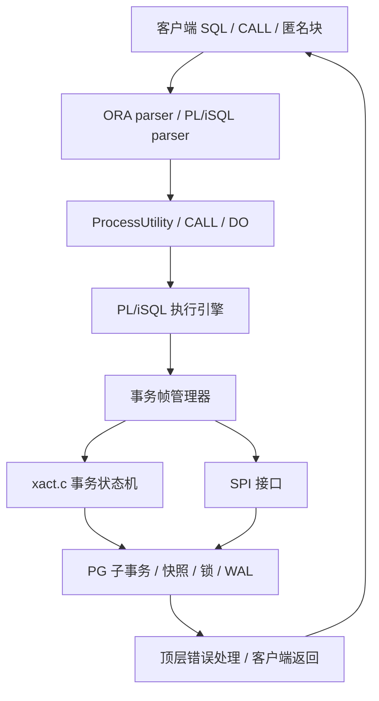

### 12.2 当前模型 vs 目标模型

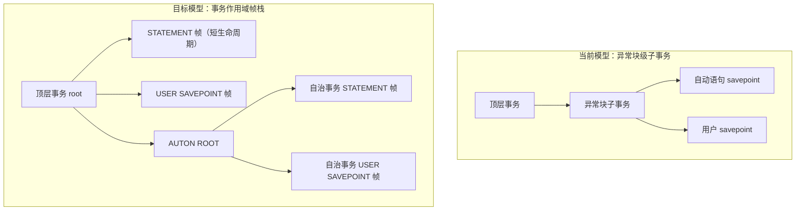

### 12.3 事务帧栈结构

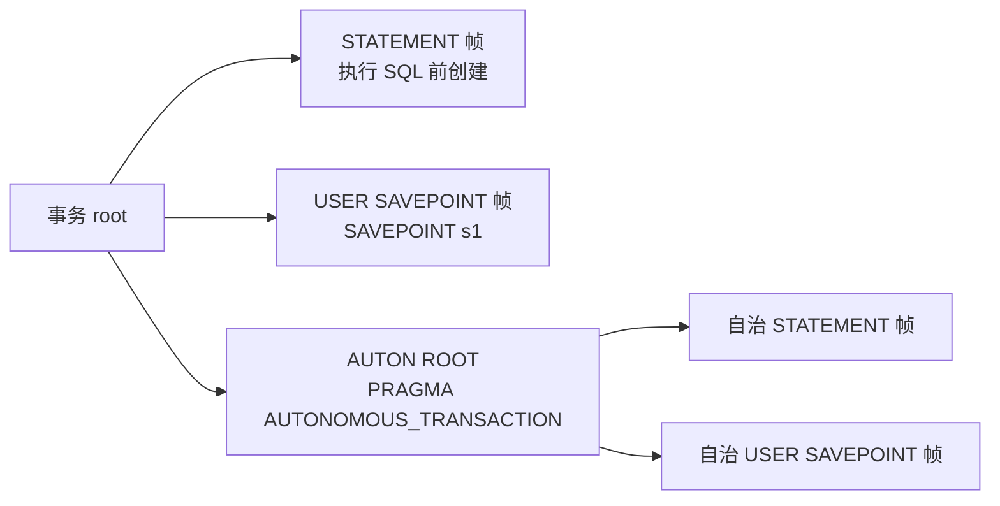

### 12.4 事务帧状态转换

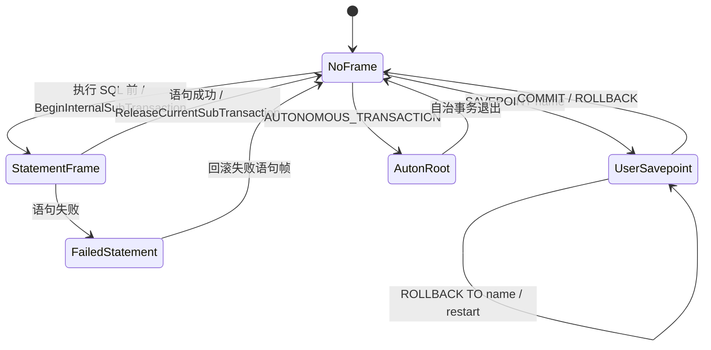

### 12.5 PL/iSQL 单条语句执行流程

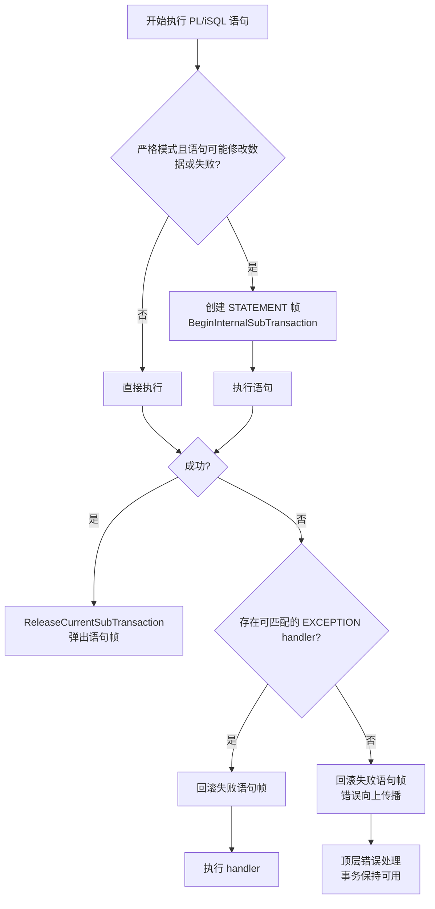

### 12.6 PL/iSQL 异常块处理流程

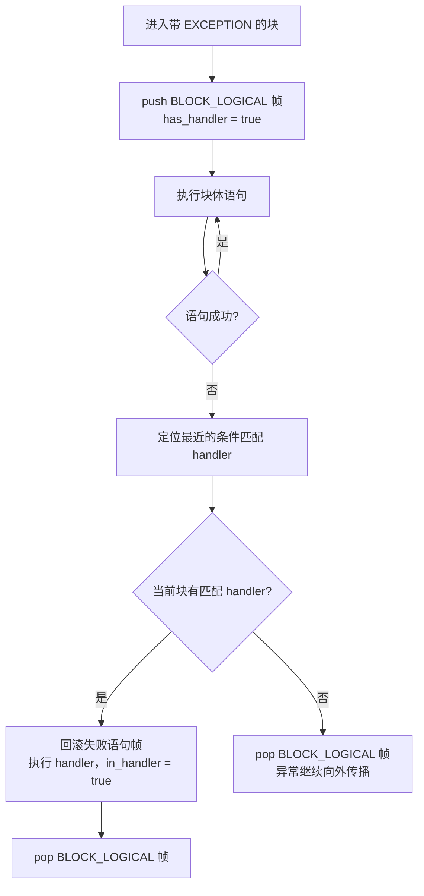

### 12.7 COMMIT 流程

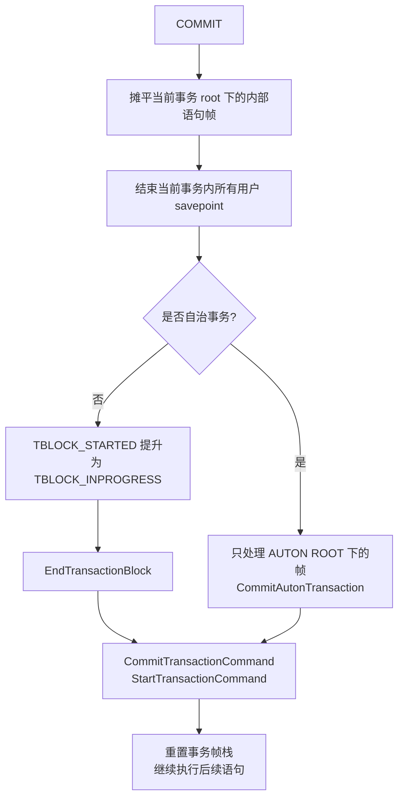

### 12.8 ROLLBACK TO SAVEPOINT 流程

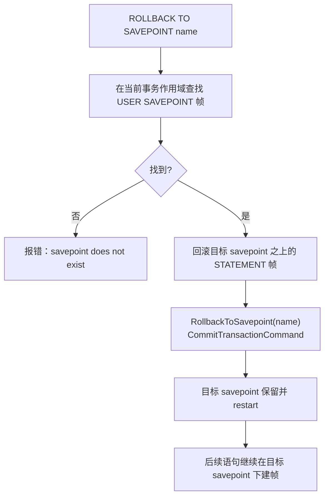

### 12.9 普通 ROLLBACK 流程

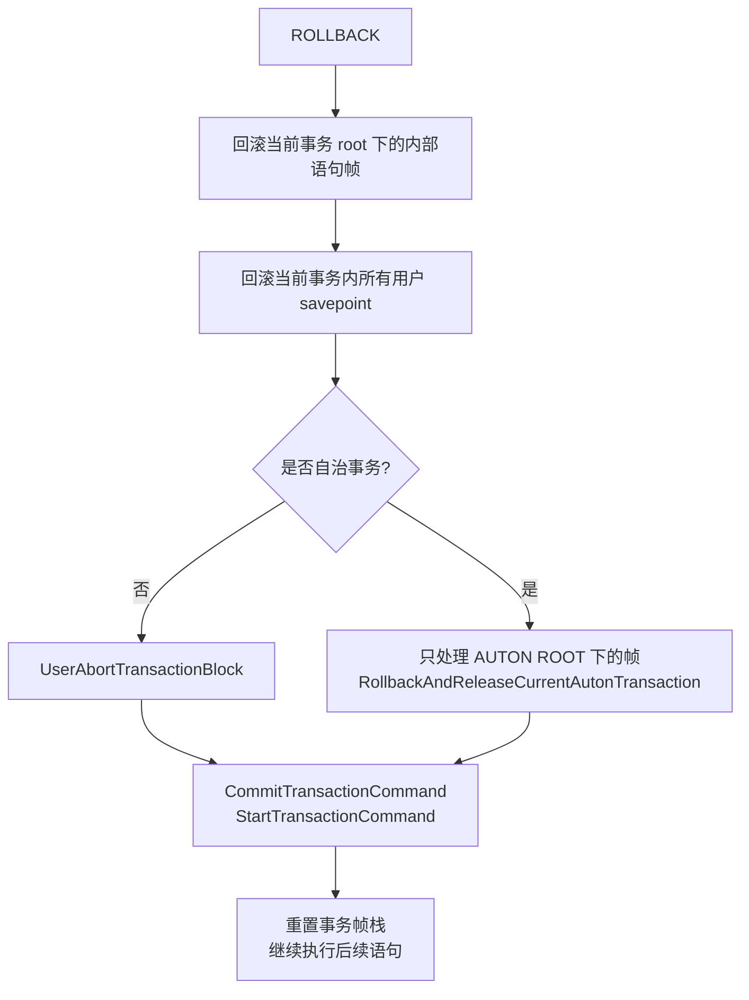

### 12.10 自治事务生命周期

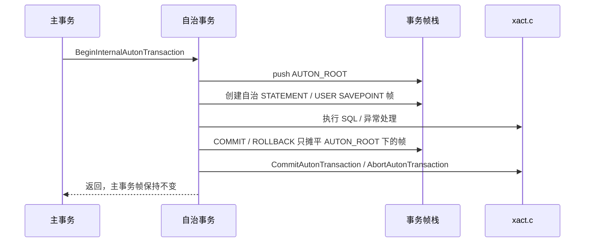

### 12.11 未处理异常的顶层恢复流程

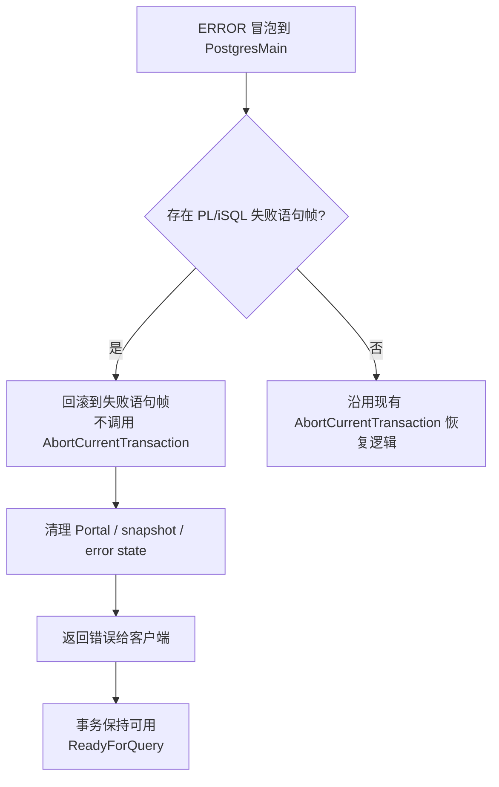

### 12.12 实施路线图


### 12.13 测试关注点关系图

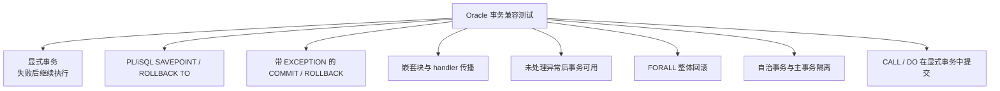

### 12.14 方案 B：Oracle 隐式事务生命周期

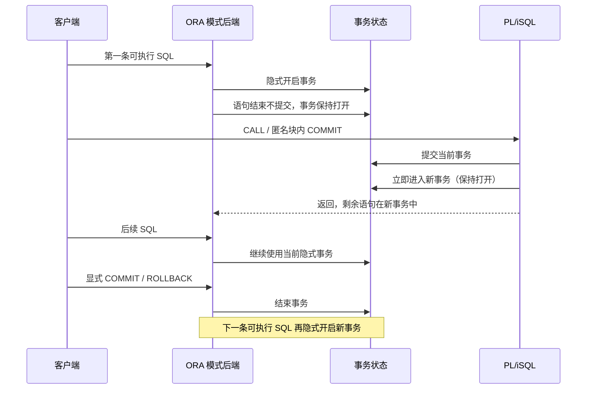

### 12.15 方案 B 下的事务状态转换

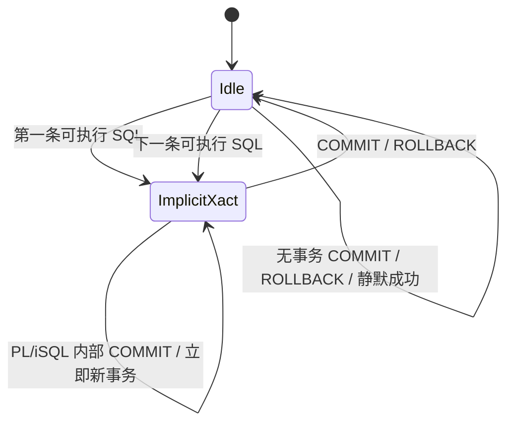

---

## 13. 结论

- 会话事务模型采用方案 B：ORA 模式模拟 Oracle 隐式事务连续性。
- 目标采用严格 Oracle 语义：未处理异常只回滚失败语句，事务保持可用。
- 子事务仍然存在，但粒度从“异常块级”改为“语句级”。
- 推荐引入事务作用域帧栈，统一普通事务、PL/iSQL、异常块、用户 savepoint、自治事务。
- 分两阶段核心落地：
  1. 语法 + 基础事务帧 + CALL/DO atomic 修正；
  2. 异常处理语句级化 + 顶层错误处理改造。
- 自治事务复用同一套帧模型，但保持独立事务边界和现有宽松退出策略。

---

## 14. 一致性复核与遗留问题（2026-11-12）

把 `ivorysql.ora_autocommit` 默认值改为 `on` 后，方案主线仍然成立，但还有以下问题需要明确，其中前三个会直接影响下一步的帧栈和错误处理设计。

### 14.1 高优先级：影响下一步设计

#### 问题 1：显式 `BEGIN` 与 `ora_autocommit=on` 的交互未定义

场景：

```sql
BEGIN;
INSERT ...;
SAVEPOINT s1;
INSERT ...;
ROLLBACK TO s1;
COMMIT;
```

如果 `on` 仍然按“每条语句结束提交”，那么：

- `BEGIN` 后 `INSERT` 结束就提交；
- `SAVEPOINT` 结束就提交，`s1` 不跨语句；
- 显式事务块退化为 autocommit。

这会让 PG 客户端常用的事务块失效。

建议：

- `BEGIN` / `START TRANSACTION` 显式进入事务块后，暂停 `ora_autocommit=on` 的自动提交；
- 直到 `COMMIT` / `ROLLBACK` 才结束；
- 显式事务块内的 `SAVEPOINT` / `ROLLBACK TO` 跨语句有效。

需要在行为矩阵中补充“显式 BEGIN 块”一行。

#### 问题 2：多语句 simple Query 在 `on` 下的提交粒度有歧义

一个 simple Query 消息里可能包含：

```sql
INSERT ...;
INSERT ...;  -- 失败
INSERT ...;
```

当前矩阵只写了“命令结束提交”，但没有定义：

- 成功的语句是否逐条提交？
- 失败语句之前已成功的语句是否保留？
- 失败语句之后是否继续执行？
- 同一消息内的 `SAVEPOINT` 是否跨内部语句有效？

建议：

- 明确 `on` 模式下 simple Query 内每条语句都是独立的 autocommit 单元；
- 或明确阶段 1 把整个 Query 消息当作一个 autocommit 单元，并在文档中标注限制。

否则阶段 1 测试会出现预期不一致。

#### 问题 3：`on` 模式下未处理异常与已成功内部语句的关系未定义

场景：

```sql
BEGIN
  INSERT INTO t VALUES (1);   -- 成功
  INSERT INTO t VALUES ('bad'); -- 失败，未处理
END;
/
```

Oracle 行为：

- 1 不回滚；
- 只回滚失败语句；
- 事务保持可用。

但 `on` 模式下顶层命令失败，是否还要提交 1，需要明确：

- 方案 A：命令失败不触发 autocommit，事务保持打开，1 未提交；
- 方案 B：回滚失败语句后，提交失败语句之前已成功的内部工作；
- 方案 C：整个顶层命令回滚（不符合 Oracle，不建议）。

这个问题会影响顶层错误处理和帧栈设计，必须先定。

### 14.2 中优先级：需要补文档或实现细节

#### 问题 4：`ora_autocommit=off` 依赖语句级错误恢复

`off` 模式要求“未处理异常只回滚失败语句、事务保持可用”，这依赖阶段 2 的顶层错误恢复改造。

建议：

- 阶段 1 默认 `on`；
- `off` 明确标注为阶段 2 完成后才完整支持；
- 或阶段 1 暂时限制 `off` 仅用于测试。

#### 问题 5：`ora_statement_level_rollback` 与新帧模型的关系

当前该 GUC 默认 `false` 且实现较粗糙。新帧模型下需要明确：

- 是否保留该 GUC；
- ORA 模式下默认是否 `on`；
- 关闭时是否退回 PG 块级回滚语义。

建议：

- 保留为性能退路；
- ORA 模式默认 `on`；
- 新帧模型作为 `on` 时的实现，`off` 时保留旧行为。

#### 问题 6：`ora_autocommit` 中途修改的边界

需要明确：

- 是否允许在事务进行中修改；
- 修改后从当前事务还是下一事务生效；
- 是否有 NOTICE/WARNING。

建议：

- 只允许事务外修改；
- 或修改后在下一事务生效；
- 有活动事务时给出明确提示。

#### 问题 7：`idle_in_transaction_session_timeout` 的忽略方式

`off` 模式下默认不应用该超时，需要明确：

- 是静默忽略；
- 还是输出 NOTICE/DEBUG；
- 还是新增 ORA 专用参数。

建议不要静默忽略用户显式设置，至少输出提示或提供专用 GUC。

#### 问题 8：`SET TRANSACTION` 在 `on` 模式下的意义

如果 `on` 模式下每条语句结束提交，那么 `SET TRANSACTION` 作为独立语句会在结束时提交，事务设置随即失效。

需要明确：

- `on` 模式下 `SET TRANSACTION` 是否自动进入显式事务；
- 还是要求用户先 `BEGIN` 或设置 `ora_autocommit=off`；
- 或直接报错提示。

### 14.3 测试矩阵必须覆盖的组合

建议至少覆盖：

| 维度 | 取值 |
|---|---|
| `ora_autocommit` | `on` / `off` |
| 显式事务 | 无 / `BEGIN` |
| 语句形式 | 单语句 / 多语句 simple Query |
| PL/iSQL | 无异常 / 有 handler / 未处理异常 |
| 事务控制 | `COMMIT` / `ROLLBACK` / `SAVEPOINT` / `ROLLBACK TO` |
| 自治事务 | 有 / 无 |

重点用例：

1. `on` + 无 `BEGIN` + 单条 DML：命令结束提交。
2. `on` + `BEGIN` + `SAVEPOINT` + `ROLLBACK TO`：显式事务块内 savepoint 有效。
3. `off` + 无 `BEGIN` + 多条 DML：事务保持打开，直到 `COMMIT`。
4. `on` + 多语句 Query 中某条失败：成功语句是否保留。
5. `on` + PL/iSQL 未处理异常：失败语句之前的工作是否保留、是否提交。
6. `off` + 未处理异常：只回滚失败语句，事务可用。
7. 自治事务内部 `COMMIT` / `ROLLBACK` / `SAVEPOINT`。
8. `SET TRANSACTION` 在 `on` / `off`、有 `BEGIN` / 无 `BEGIN` 下的行为。

> 本节问题 1–3 的建议已被接受，具体设计见第 15 节。

---

## 15. 下一步设计：事务帧栈与顶层错误处理

> 本节为初版设计。基于复核意见的 v2.0 修订见第 17 节，重点修正错误捕获边界、未处理 PL/iSQL 异常、帧栈与子事务同步、SPI 提交限制和 `ora_autocommit` 定位。第 15、16 节保留为设计演进记录。

### 15.1 已接受的设计决策

1. 显式 `BEGIN` / `START TRANSACTION` 覆盖 `ora_autocommit=on`：
   - 进入显式事务块后暂停自动提交；
   - 直到 `COMMIT` / `ROLLBACK` 才结束；
   - 显式事务块内 `SAVEPOINT` / `ROLLBACK TO` 跨语句有效。

2. 多语句 simple Query：
   - 目标语义是每条内部语句都是独立的 autocommit 单元；
   - 阶段 1 即使暂不能逐语句继续执行，也要做到：
     - 成功语句独立提交；
     - 失败语句只回滚自己；
     - 中止当前 Query 消息的后续语句；
     - 事务保持可用；
   - 阶段 2 再实现逐语句继续。

3. `ora_autocommit=on` 下未处理异常：
   - 只回滚失败语句；
   - 失败语句之前已经成功的内部工作保留；
   - 事务保持打开；
   - 失败命令不触发自动提交；
   - 下一次成功完成的顶层命令再触发自动提交。

### 15.2 事务帧栈的位置

建议放在**事务作用域**，而不是单个 `PLiSQL_execstate`：

- SQL 顶层语句和 PL/iSQL 内部语句要共享同一个用户 savepoint 命名空间；
- 自治事务要有独立 root；
- 顶层 `COMMIT` / `ROLLBACK` 后要能统一失效所有帧。

**已确认：采用“独立全局对象 + 自治事务 root 保存/恢复”方案。**

- 不使用 `TransactionStateData` 直接持有帧栈；
- 在 `ora_txframe.c` 内维护全局帧栈对象；
- 自治事务进入时保存外层 root/current，并创建新的 `AUTON_ROOT`；
- 自治事务退出时恢复外层 root/current；
- 通过 transaction epoch 做失效检测。

这样做的原因：

- SQL 层和 PL/iSQL 层共享同一套帧栈，集成点更集中；
- 不需要改动 `TransactionStateData` 的复制/初始化逻辑；
- 自治事务边界可以通过显式保存/恢复实现，和现有 `autonxiso` 机制一致；
- 便于在 `postgres.c`、`xact.c`、`pl_exec.c` 中统一调用。

### 15.3 帧类型与创建规则

```c
typedef enum OraTxFrameKind
{
    ORA_TXFRAME_TOP,            /* 顶层事务 root */
    ORA_TXFRAME_AUTON_ROOT,     /* 自治事务 root */
    ORA_TXFRAME_STATEMENT,      /* 内部语句 savepoint */
    ORA_TXFRAME_USER_SAVEPOINT, /* 用户 SAVEPOINT */
    ORA_TXFRAME_BLOCK           /* PL/iSQL 异常块逻辑帧 */
} OraTxFrameKind;

typedef struct OraTxFrame
{
    struct OraTxFrame *parent;
    OraTxFrameKind     kind;
    char              *name;          /* 用户 savepoint 名，内部帧可为 NULL */
    SubTransactionId   subxid;        /* 对应 PG 子事务 */
    bool               subxact_alive;
    bool               has_handler;   /* BLOCK 帧使用 */
    bool               in_handler;    /* BLOCK 帧使用 */
    uint64             epoch;         /* 事务世代 */
    void              *owner;         /* PLiSQL_execstate 或 NULL */
} OraTxFrame;
```

创建规则：

| 语句/结构 | 是否创建 STATEMENT 帧 | 说明 |
|---|---|---|
| 顶层普通 SQL（DML/DDL/SELECT） | `on` + 无显式事务时可不建；`off` 或显式事务块内建 | 显式事务块内失败要保留事务 |
| PL/iSQL `EXECSQL` | 建 | 失败时只回滚该语句 |
| PL/iSQL 动态 SQL | 建 | 同上 |
| `FORALL` | 整个 `FORALL` 一个帧 | Oracle 整体回滚 |
| `CALL` / `BLOCK` / `IF` / `LOOP` | 不建 | 由内部叶子语句帧负责 |
| 用户 `SAVEPOINT` | 建 USER 帧 | 事务作用域 |
| 自治事务 | 建 AUTON_ROOT | 内部再建语句帧 |

说明：

- `CALL` 和嵌套块本身不建 STATEMENT 帧，符合 Oracle “子程序未处理异常时不回滚子程序之前成功修改”的行为；
- 只有叶子 SQL 语句建帧，可以避免“外层语句帧过大”导致回滚过多；
- `FORALL` 是例外，Oracle 要求整体回滚。

### 15.4 事务帧栈生命周期

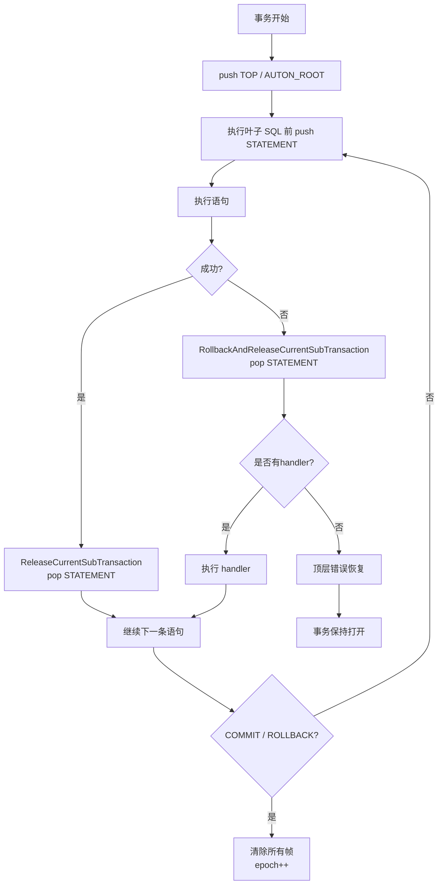

### 15.5 帧栈操作 API

建议新增：

```c
void OraTxFrameInit(void);
void OraTxFrameReset(bool isCommit);
void OraTxFramePushStatement(void *owner, SubTransactionId subxid);
void OraTxFramePopStatement(void);
void OraTxFramePushUserSavepoint(const char *name, SubTransactionId subxid);
void OraTxFramePushBlock(void *owner);
void OraTxFramePopBlock(void);
OraTxFrame *OraTxFrameFindUserSavepoint(const char *name);
OraTxFrame *OraTxFrameCurrent(void);
bool OraTxFrameIsValid(const OraTxFrame *frame);
uint64 OraTxFrameEpoch(void);
```

关键：

- `FindUserSavepoint` 只匹配 `ORA_TXFRAME_USER_SAVEPOINT`；
- 内部 `STATEMENT` 帧永远不能被用户 `ROLLBACK TO` 命中；
- 所有帧都带 epoch，epoch 不匹配即视为失效；
- `COMMIT` / `ROLLBACK` 后统一 `OraTxFrameReset`。

### 15.6 顶层错误恢复算法

目标：未处理异常不调用 `AbortCurrentTransaction()` 把整个事务干掉。

建议在 `PostgresMain` 的错误处理路径中增加 ORA 专用恢复：

```c
/*
 * 伪代码：ERROR 后的恢复
 */
if (ORA_MODE)
{
    if (OraRecoverFailedStatement())
    {
        /* 事务仍然有效，继续清理并返回错误 */
    }
    else
    {
        AbortCurrentTransaction();
    }
}
else
{
    AbortCurrentTransaction();
}
```

`OraRecoverFailedStatement()` 逻辑：

```c
bool
OraRecoverFailedStatement(void)
{
    OraTxFrame *frame = OraTxFrameCurrent();

    if (frame == NULL)
        return false;

    if (frame->kind != ORA_TXFRAME_STATEMENT)
        return false;

    if (!OraTxFrameIsValid(frame))
    {
        OraTxFrameReset(false);
        return false;
    }

    /* 只回滚失败语句，不 abort 整个事务 */
    RollbackAndReleaseCurrentSubTransaction();
    OraTxFramePopStatement();

    /* 事务状态应回到 TBLOCK_INPROGRESS / ORA_IMPLICIT_INPROGRESS */
    return true;
}
```

需要注意：

1. 错误可能发生在嵌套子事务中；只回滚最内层失败语句帧。
2. 失败语句之前的叶子语句已经成功 release，因此不会被回滚。
3. `CALL` / 嵌套块不建帧，因此不会出现“外层语句帧被整体回滚”的问题。
4. 如果错误发生在 `FORALL` 内部，回滚整个 `FORALL` 帧。
5. 如果当前帧是用户 savepoint 或块逻辑帧，不使用该路径，交给原有 abort 或上层 handler。
6. 恢复后要执行原有的 Portal / snapshot / memory context 清理，但不结束事务。

### 15.7 自动提交与主循环集成

建议增加 session 级状态：

```c
bool OraAutocommit;      /* 对应 ivorysql.ora_autocommit */
bool OraExplicitTxn;     /* 显式 BEGIN 后为 true */
uint64 OraTxEpoch;       /* 事务世代 */
```

主循环逻辑：

```text
每条顶层命令开始:
  if ORA_MODE:
      if command == BEGIN / START TRANSACTION:
          OraExplicitTxn = true
      decide whether this command is an autocommit unit:
          OraAutocommit && !OraExplicitTxn

每条顶层命令结束:
  if success && OraAutocommit && !OraExplicitTxn:
      commit
  else if failure:
      do not commit
      recover failed statement
  if command == COMMIT / ROLLBACK:
      OraExplicitTxn = false
```

多语句 simple Query：

- `on` + 非显式事务：
  - 每条语句成功后独立提交；
  - 失败语句回滚后，阶段 1 中止当前消息后续语句。
- `off` 或显式事务：
  - 整个消息内不逐语句提交；
  - 直到 `COMMIT` / `ROLLBACK`。

### 15.8 用户 savepoint 跨层查找

- SQL `SAVEPOINT` 和 PL/iSQL `SAVEPOINT` 使用同一个 API；
- `ROLLBACK TO` 只查找 `ORA_TXFRAME_USER_SAVEPOINT`；
- 目标 savepoint 之上的 `STATEMENT` 帧全部回滚；
- 目标 savepoint 保留并 restart；
- 自治事务内的查找范围只限当前 `AUTON_ROOT` 子树；
- 主事务和自治事务的 savepoint 互不可见。

### 15.9 代码落点

| 模块 | 改动 |
|---|---|
| `src/backend/access/transam/ora_txframe.c` / `.h` | 新增帧栈管理模块 |
| `src/backend/access/transam/xact.c` | 事务生命周期回调、epoch、自治事务 root |
| `src/backend/tcop/postgres.c` | 顶层错误恢复、自动提交、显式事务状态 |
| `src/backend/tcop/utility.c` | `CALL` / `DO` atomic 判定 |
| `src/backend/executor/spi.c` | 嵌套提交/回滚 API |
| `src/pl/plisql/src/pl_exec.c` | 去掉块级子事务、叶子语句帧、异常处理 |
| `src/pl/plisql/src/pl_gram.y` | 新增事务语法 |
| `src/pl/plisql/src/plisql.h` / `pl_funcs.c` | AST、free、dump |
| `src/backend/utils/misc/ivy_oracle_guc.c` | `ivorysql.ora_autocommit` |

### 15.10 本阶段需要先实现的验证点

1. `ora_autocommit=on` + 单条 DML：成功提交，失败只回滚该语句。
2. `ora_autocommit=on` + 显式 `BEGIN`：内部语句不自动提交，`SAVEPOINT` 跨语句有效。
3. `ora_autocommit=off` + 多条 DML：事务保持打开，直到 `COMMIT`。
4. PL/iSQL 叶子语句失败：只回滚该语句，前一条语句保留。
5. PL/iSQL 未处理异常：事务保持打开，下一次成功命令可提交之前的工作。
6. `FORALL` 失败：整体回滚。
7. 自治事务内失败：只影响自治事务，主事务帧不受影响。

### 15.11 仍未关闭的问题

1. 帧栈最终挂在 `TransactionStateData` 还是独立全局对象。
2. `SET TRANSACTION` 在 `on` 模式下的行为。
3. `idle_in_transaction_session_timeout` 的具体忽略方式。
4. `ora_autocommit` 中途修改的生效边界。
5. DDL 隐式提交是否本期实现。
6. 错误码是否 Oracle 化（如 `ORA-01086`）。

---

## 16. 函数级设计与改动顺序

> 本节为 v1 函数级设计。第 17 节给出 v2.0 修订后的错误捕获边界、事务控制器和实施顺序；编码应以第 17 节为准。

### 16.1 新增模块：`ora_txframe`

新增文件：

- `src/include/access/ora_txframe.h`
- `src/backend/access/transam/ora_txframe.c`

核心 API：

```c
/* 事务边界 */
void OraTxFrameOnTopStart(void);
void OraTxFrameOnTopCommit(void);
void OraTxFrameOnTopAbort(void);
void OraTxFrameOnSubCommit(SubTransactionId subid);
void OraTxFrameOnSubAbort(SubTransactionId subid);

/* 自治事务边界 */
void OraTxFramePushAutonRoot(void);
void OraTxFramePopAutonRoot(void);

/* 语句帧 */
void OraTxFramePushStatement(SubTransactionId subid, void *owner);
void OraTxFramePopStatement(void);
OraTxFrame *OraTxFrameInnermostStatement(void);

/* 用户 savepoint */
void OraTxFramePushUserSavepoint(const char *name, SubTransactionId subid);
OraTxFrame *OraTxFrameFindUserSavepoint(const char *name);

/* 异常块逻辑帧 */
void OraTxFramePushBlock(void *owner, bool has_handler);
void OraTxFramePopBlock(void);

/* 状态查询与清理 */
OraTxFrame *OraTxFrameCurrent(void);
bool OraTxFrameIsValid(const OraTxFrame *frame);
bool OraTxFrameHasActiveHandler(void);
void OraTxFrameReset(void);
uint64 OraTxFrameEpoch(void);
```

数据结构和帧类型沿用第 15 节定义。

### 16.2 `xact.c` 改动

#### 需要挂接的位置

| 位置 | 调用 |
|---|---|
| `StartTransaction` / `StartTransactionCommand` | `OraTxFrameOnTopStart` |
| `CommitTransaction` | `OraTxFrameOnTopCommit` |
| `AbortTransaction` | `OraTxFrameOnTopAbort` |
| `CommitSubTransaction` | `OraTxFrameOnSubCommit(subid)` |
| `AbortSubTransaction` | `OraTxFrameOnSubAbort(subid)` |
| `BeginInternalAutonTransaction` | `OraTxFramePushAutonRoot` |
| `ReleaseCurrentAutonTransaction` | `OraTxFramePopAutonRoot` |
| `RollbackAndReleaseCurrentAutonTransaction` | `OraTxFramePopAutonRoot` |

#### 需要修改的函数

- `EndTransactionBlock`：
  - ORA 模式下无事务 `COMMIT` 静默成功；
  - 显式事务块结束后清理 `OraExplicitTxn`。
- `UserAbortTransactionBlock`：
  - ORA 模式下无事务 `ROLLBACK` 静默成功。
- `CommitTransactionCommand` / `AbortCurrentTransaction`：
  - 确认 ORA 隐式事务状态不误入 `TBLOCK_ABORT`。

### 16.3 `postgres.c` 改动

#### 新增辅助函数

```c
static bool ora_autocommit_enabled(void);
static bool ora_in_explicit_txn(void);
static void ora_begin_top_command(Node *parsetree);
static void ora_end_top_command(bool success);
static bool ora_recover_failed_statement(void);
```

#### `exec_simple_query`

需要处理：

1. `ora_autocommit=on` 且非显式事务：
   - 每条内部语句作为独立事务；
   - 成功语句提交；
   - 失败语句中止当前消息后续语句（阶段 1）。
2. `ora_autocommit=off` 或显式事务：
   - 维持事务连续性；
   - 每条语句创建顶层 `STATEMENT` 帧；
   - 失败时只回滚该帧。
3. `BEGIN` / `START TRANSACTION`：
   - 设置 `OraExplicitTxn = true`；
   - 暂停自动提交。
4. `COMMIT` / `ROLLBACK`：
   - 清除 `OraExplicitTxn`；
   - 清理事务帧。

#### `exec_execute_message`

- 在执行前调用 `ora_begin_top_command`；
- 执行后按成功/失败调用 `ora_end_top_command`；
- 失败时走 `ora_recover_failed_statement`。

#### `PostgresMain` 错误处理

当前路径：

```c
AbortCurrentTransaction();
```

改为：

```c
if (compatible_mode == ORA_MODE &&
    ora_recover_failed_statement())
{
    /* 事务保持可用 */
}
else
{
    AbortCurrentTransaction();
}
```

`ora_recover_failed_statement()` 逻辑见 15.6。

### 16.4 `pl_exec.c` 改动

#### `exec_stmt_block`

- 去掉块入口的 `BeginInternalSubTransaction(NULL)`；
- 改为 `OraTxFramePushBlock(estate, block->exceptions != NULL)`；
- 块正常结束：`OraTxFramePopBlock`；
- `PG_CATCH` 中：
  - `OraTxFrameRollbackFailedStatement()`；
  - 执行 handler；
  - handler 执行期间 `in_handler = true`。

#### `exec_stmts_ext`

新增逻辑：

```c
if (plisql_stmt_needs_statement_frame(stmt))
{
    BeginInternalSubTransaction(NULL);
    OraTxFramePushStatement(GetCurrentSubTransactionId(), estate);
}
```

语句成功后：

```c
ReleaseCurrentSubTransaction();
OraTxFramePopStatement();
```

语句失败时由 `exec_stmt_block` 的 catch 或顶层恢复处理。

#### 新增函数

```c
static bool plisql_stmt_needs_statement_frame(PLiSQL_stmt *stmt);
static int exec_stmt_savepoint(PLiSQL_execstate *estate,
                               PLiSQL_stmt_txn *stmt);
static int exec_stmt_rollback_to(PLiSQL_execstate *estate,
                                 PLiSQL_stmt_txn *stmt);
static int exec_stmt_set_transaction(PLiSQL_execstate *estate,
                                     PLiSQL_stmt_txn *stmt);
```

#### 需要修改的函数

- `exec_stmt_commit`：
  - 使用 `SPI_commit_allow_subxact()`；
  - 提交前 `OraTxFrameUnwindForCommit()`；
  - 提交后重新初始化帧栈。
- `exec_stmt_rollback`：
  - 使用 `SPI_rollback_allow_subxact()`；
  - 回滚前 `OraTxFrameReset()`；
  - 回滚后重新初始化帧栈。
- `exec_stmt_forall`：
  - 整个 `FORALL` 一个 `STATEMENT` 帧；
  - 内部迭代不单独建帧。
- `exec_stmt_call`：
  - 不建顶层 `STATEMENT` 帧；
  - 由被调用子程序的叶子语句帧负责回滚。

### 16.5 `spi.c` 改动

新增：

```c
static void _SPI_commit_ext(bool chain, bool allow_subxact);
static void _SPI_rollback_ext(bool chain, bool allow_subxact);

void SPI_commit_allow_subxact(void);
void SPI_rollback_allow_subxact(void);
```

`allow_subxact = true` 时：

- 不因 `IsSubTransaction()` 直接报错；
- 先 `EndTransactionBlock` / `UserAbortTransactionBlock`；
- 再 `CommitTransactionCommand` / `StartTransactionCommand`；
- 保留 `HoldPinnedPortalsExt` / `ForgetPortalSnapshotsExt` 处理。

### 16.6 `utility.c` 改动

`standard_ProcessUtility` 中：

```c
if (compatible_mode == ORA_MODE &&
    (IsA(parsetree, CallStmt) || IsA(parsetree, DoStmt)))
    isAtomicContext = false;
```

需要保留：

- 函数、触发器 atomic；
- package SECURITY DEFINER / AUTHID 特殊判断；
- `CALL` 函数而非过程时的报错。

### 16.7 GUC 改动

`ivy_oracle_guc.c` 新增：

```c
bool ora_autocommit = true;
```

```c
{"ivorysql.ora_autocommit", PGC_USERSET, COMPAT_ORACLE_OPTIONS, ...}
```

建议增加：

- `check_ora_autocommit`：事务中修改时给出错误或提示；
- `assign_ora_autocommit`：设置 session flag；
- 仅 ORA 模式生效。

### 16.8 语法与 AST 改动

- `pl_gram.y`：
  - 新增 `K_SAVEPOINT`、`K_WORK`、`K_COMMENT`、`K_WRITE`、`K_WAIT`、`K_NOWAIT`、`K_BATCH`、`K_FORCE`、`K_SET`、`K_TRANSACTION` 等；
  - 新增 `stmt_savepoint`、扩展 `stmt_rollback`、扩展 `stmt_commit`。
- `plisql.h`：
  - 新增 `PLISQL_STMT_TXN` 或独立节点。
- `pl_funcs.c`：
  - `plisql_stmt_type_name`、`free_stmt`、`dump_stmt`。

### 16.9 实施顺序

#### 阶段 0：骨架，无行为变化

- 新增 `ora_txframe` 模块；
- 新增 GUC 占位，默认暂保持 `false`；
- 增加 session flag、调试日志；
- 现有测试保持通过。

#### 阶段 1：顶层普通 SQL 语句帧 + 错误恢复

- `off` / 显式事务下为顶层普通 SQL 建 `STATEMENT` 帧；
- `PostgresMain` 错误路径接入 `ora_recover_failed_statement`；
- 测试 `BEGIN; INSERT ...; INSERT bad; INSERT ...; COMMIT;`。

#### 阶段 2：PL/iSQL 叶子语句帧 + 去掉块级子事务

- 修改 `exec_stmt_block` / `exec_stmts_ext`；
- 异常时只回滚失败语句；
- 测试有 handler / 无 handler / 嵌套块。

#### 阶段 3：嵌套子事务提交/回滚 + CALL/DO atomic

- 新增 `SPI_commit_allow_subxact` / `SPI_rollback_allow_subxact`；
- 修复 `isAtomicContext`；
- 测试 `EXCEPTION` 块内 `COMMIT`、显式事务内 `CALL`。

#### 阶段 4：PL/iSQL 事务语法和 savepoint

- 新增 `SAVEPOINT` / `ROLLBACK TO` / Oracle `COMMIT` / `ROLLBACK` / `SET TRANSACTION`；
- 测试 SQL 与 PL/iSQL 跨层 savepoint。

#### 阶段 5：自动提交默认 `on` + 多语句

- 实现显式 `BEGIN` 覆盖自动提交；
- 实现多语句 simple Query 的逐语句提交（阶段 1 限制：失败后中止后续）；
- 把 `ora_autocommit` 默认值从占位的 `false` 改为 `true`；
- 跑完整行为矩阵。

#### 阶段 6：自治事务统一

- 自治事务使用独立帧栈 root；
- 修复自治事务内 `EXCEPTION` + `COMMIT`；
- 测试嵌套自治事务、游标、临时表。

#### 阶段 7：SQL 层语法、DDL、隔离级别

- `COMMIT WRITE` / `COMMIT COMMENT` / `COMMIT FORCE`；
- `SET TRANSACTION READ ONLY`；
- 视需求实现 DDL 隐式提交。

#### 阶段 8：回归与性能

- 更新 expected；
- 增加 on/off 双模式测试；
- 评估子事务开销。

### 16.10 阶段验收用例

```sql
-- 1. off + 显式事务，失败后事务可用
BEGIN;
INSERT INTO t VALUES (1);
INSERT INTO t VALUES ('bad');
INSERT INTO t VALUES (2);
COMMIT;
-- 期望：1、2 保留

-- 2. on + 显式 BEGIN，显式事务覆盖 autocommit
BEGIN;
INSERT INTO t VALUES (1);
SAVEPOINT s1;
INSERT INTO t VALUES (2);
ROLLBACK TO s1;
COMMIT;
-- 期望：1 保留，2 回滚

-- 3. PL/iSQL handler
BEGIN
  INSERT INTO t VALUES (1);
  INSERT INTO t VALUES ('bad');
  INSERT INTO t VALUES (2);
EXCEPTION
  WHEN OTHERS THEN
    INSERT INTO t VALUES (3);
    COMMIT;
END;
/
-- 期望：1、3 保留

-- 4. PL/iSQL 未处理异常
BEGIN
  INSERT INTO t VALUES (1);
  INSERT INTO t VALUES ('bad');
END;
/
-- 期望：1 保留，事务可用，可以继续执行并 COMMIT

-- 5. 自治事务
DECLARE
  PRAGMA AUTONOMOUS_TRANSACTION;
BEGIN
  INSERT INTO log VALUES (1);
  COMMIT;
END;
/
-- 期望：自治事务提交，不影响主事务
```

### 16.11 已确认的编码前决策

1. **帧栈挂载方式**
   - 采用“独立全局对象 + 自治事务 root 保存/恢复”；
   - 不直接挂 `TransactionStateData`；
   - 具体实现放在 `ora_txframe.c`。

2. **`ora_autocommit` 开发期默认值**
   - 阶段 0–4 先保持 `false`，避免提前改变现有行为；
   - 阶段 5 完成后再改为默认 `true`。

3. **`ROLLBACK TO` 的 Portal / snapshot 清理**
   - 参考 `_SPI_commit` / `_SPI_rollback` 的处理方式；
   - 使用 `HoldPinnedPortalsExt` / `ForgetPortalSnapshotsExt` 处理目标 savepoint 之上的 pinned portal 和 portal snapshot；
   - 需要专门测试游标、`sys_refcursor`、holdable cursor 在 `ROLLBACK TO` 前后的行为。

4. **`idle_in_transaction_session_timeout` 的实现位置**
   - 用户显式设置仍然生效，不静默跳过；
   - 默认值 0 时不启用，无需特殊处理；
   - 在文档中说明 ORA 隐式事务可能长期处于 idle in transaction，用户可自行配置该超时；
   - 后续如需 ORA 专用控制，再增加独立参数。

5. **`ivorysql.ora_statement_level_rollback` 与新帧模型的关系**
   - 过渡期并存；
   - v2.4 起默认 `off`，不启用新帧模型；
   - 设为 `on` 时走新帧模型；
   - 新帧模型稳定后再评估是否废弃旧实现。

---

## 17. v2.0 内核实现设计修订

### 17.1 复核结论

第 15、16 节的方向正确，但有以下问题需要修订后才能编码：

1. 不能在 `PostgresMain` 直接回滚语句子事务；
2. 未处理的纯 PL/iSQL 异常没有完整恢复路径；
3. 事务帧栈与 PG 子事务栈必须严格同步；
4. 不能简单绕过 SPI 的子事务保护；
5. `ora_autocommit` 的定位需要重新表述；
6. DDL 隐式提交、`FORALL SAVE EXCEPTIONS`、`SET TRANSACTION` 的优先级需要调整。

### 17.2 v2.0 总原则

1. **SQL 语句失败，只能由对应语句执行边界负责回滚。**
   - 不能把所有回滚责任都推到 `PostgresMain`；
   - 语句执行边界负责创建帧、成功 release、失败 rollback。

2. **PL/iSQL 异常传播不等于事务回滚。**
   - 纯 PL/iSQL 异常（`RAISE`、运行时异常）不能撤销此前成功的 DML；
   - 只有存在活动 `STATEMENT` 帧时，才回滚对应 SQL 语句。

3. **`ora_txframe` 只管理逻辑事务帧。**
   - 物理事务状态、ResourceOwner、MemoryContext、锁、快照仍由 PostgreSQL `xact.c` / `SPI` 负责；
   - 不能让 `ora_txframe` 成为第二套事务管理器。

4. **`PostgresMain` 只处理未被局部执行边界恢复的错误。**
   - 语句边界先做局部恢复；
   - `PostgresMain` 负责协议恢复、错误返回和最终 fallback。

5. **PG 子事务状态是物理权威。**
   - 帧只记录逻辑关系；
   - 所有物理子事务操作必须通过统一包装接口同步帧；
   - xact 子事务回调只做一致性修正和安全网。

### 17.3 修订后的分层架构

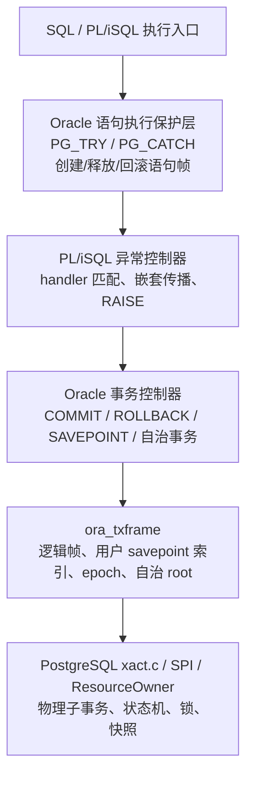

### 17.4 错误捕获边界重构

#### 17.4.1 顶层 SQL 语句边界

位置：

- `exec_simple_query` 的每条 parsetree；
- `exec_execute_message` 的 `PortalRun`。

建议结构：

```c
OraBeginTopStatementFrameIfNeeded(parsetree);

PG_TRY();
{
    PortalRun(...);

    OraEndTopStatementSuccessIfNeeded();
}
PG_CATCH();
{
    ErrorData *edata;

    edata = CopyErrorData();
    FlushErrorState();

    OraRecoverAtTopStatementBoundary();

    ReThrowError(edata);
}
PG_END_TRY();
```

要求：

- 事务控制语句（`BEGIN` / `COMMIT` / `ROLLBACK` / `SAVEPOINT` / `ROLLBACK TO`）不建语句帧；
- `CALL` / `DO` 由顶层语句帧覆盖；内部实际 SQL 语句由叶子帧负责；
- 错误恢复后若事务仍然可用，设置 `OraLocalErrorRecovered = true`，再 rethrow；
- `PostgresMain` 看到该标记后跳过 `AbortCurrentTransaction()`。

#### 17.4.2 PL/iSQL 叶子语句边界

位置：`exec_stmts_ext` 的每条可能失败的 SQL 语句。

```c
if (plisql_stmt_needs_statement_frame(stmt))
{
    BeginInternalSubTransaction(NULL);
    OraTxFramePushStatement(GetCurrentSubTransactionId(), estate);
}

PG_TRY();
{
    rc = exec_statement(...);

    if (frame_created)
    {
        ReleaseCurrentSubTransaction();
        OraTxFramePopStatement();
    }
}
PG_CATCH();
{
    ErrorData *edata = CopyErrorData();

    FlushErrorState();

    if (frame_created)
    {
        RollbackAndReleaseCurrentSubTransaction();
        OraTxFramePopStatement();
    }

    ReThrowError(edata);
}
PG_END_TRY();
```

要求：

- 叶子语句失败时，只回滚该语句帧；
- 回滚后 rethrow 给 `exec_stmt_block` 的 catch 做 handler 匹配；
- `COMMIT` / `ROLLBACK` / `SAVEPOINT` / `ROLLBACK TO` 不建语句帧；
- `FORALL` 整体一个帧；
- `CALL` / `BLOCK` / `IF` / `LOOP` 不建帧。

#### 17.4.3 异常块 handler 边界

位置：`exec_stmt_block` 的 `PG_CATCH`。

职责：

- 接收叶子语句 rethrow 上来的错误；
- 匹配 handler；
- 执行 handler；
- handler 中的语句仍然走叶子语句边界；
- 不在块级再次回滚已经回滚过的语句帧。

#### 17.4.4 `PostgresMain` fallback

`PostgresMain` 的职责：

1. `EmitErrorReport()`；
2. 如果 `OraLocalErrorRecovered == true`：
   - 跳过 `AbortCurrentTransaction()`；
   - 做 Portal / snapshot / memory context / replication slot 等清理；
   - 返回错误，事务保持可用；
3. 否则：
   - 沿用现有 `AbortCurrentTransaction()`。

### 17.5 未处理 PL/iSQL 异常

场景：

```sql
BEGIN
    INSERT INTO t VALUES (1);
    RAISE_APPLICATION_ERROR(-20001, 'test error');
END;
/
```

Oracle 期望：

- `1` 保留；
- 异常返回客户端；
- 事务保持可用。

v2.0 规则：

1. `INSERT` 成功后它的 `STATEMENT` 帧已经 release，修改进入外层事务；
2. `RAISE` 本身不是 SQL 语句，没有活动 `STATEMENT` 帧；
3. 顶层语句边界捕获到错误后，不回滚此前成功的 DML；
4. 设置 `OraLocalErrorRecovered = true`；
5. `PostgresMain` 跳过 `AbortCurrentTransaction()`；
6. 事务保持打开，下一次成功命令可以提交之前的工作。

错误来源可以引入内部枚举辅助判断，但最终规则是：

> 只有存在活动 `STATEMENT` 帧时，才回滚该帧；纯 PL/iSQL 异常不回滚此前成功的 SQL。

### 17.6 帧栈与 PG 子事务同步契约

#### 17.6.1 权威关系

- PG 子事务状态是物理权威；
- `ora_txframe` 只记录逻辑类型、用户 savepoint 查找、handler、epoch；
- 帧中保存 `subxid`，操作前必须校验 `GetCurrentSubTransactionId()`。

#### 17.6.2 统一包装接口

```c
void OraTxBeginStatement(void);          /* BeginInternalSubTransaction + push frame */
void OraTxEndStatementSuccess(void);     /* ReleaseCurrentSubTransaction + pop frame */
void OraTxEndStatementError(void);       /* RollbackAndReleaseCurrentSubTransaction + pop frame */
void OraTxDefineUserSavepoint(const char *name);
void OraTxRollbackToUserSavepoint(const char *name);
void OraTxCommitCurrent(void);
void OraTxRollbackCurrent(void);
```

#### 17.6.3 状态转换

| 操作 | PG 子事务动作 | 帧动作 |
|---|---|---|
| 语句开始 | `BeginInternalSubTransaction` | push `STATEMENT` |
| 语句成功 | `ReleaseCurrentSubTransaction` | pop `STATEMENT` |
| 语句失败 | `RollbackAndReleaseCurrentSubTransaction` | pop `STATEMENT` |
| `SAVEPOINT` | `DefineSavepoint` + `CommitTransactionCommand` | push `USER_SAVEPOINT` |
| `ROLLBACK TO` | `RollbackToSavepoint` + `CommitTransactionCommand` | 删除目标之上的帧，保留并更新目标 |
| `COMMIT` | `EndTransactionBlock` + `CommitTransactionCommand` | 清空当前事务 root 下所有帧 |
| `ROLLBACK` | `UserAbortTransactionBlock` + `CommitTransactionCommand` | 清空当前事务 root 下所有帧 |
| 自治事务进入 | `BeginInternalAutonTransaction` | 保存外层栈，push `AUTON_ROOT` |
| 自治事务退出 | `ReleaseCurrentAutonTransaction` / 回滚 | pop `AUTON_ROOT`，恢复外层栈 |

#### 17.6.4 xact 回调

- `OraTxFrameOnSubCommit(subid)` / `OraTxFrameOnSubAbort(subid)` 只做安全网；
- 如果包装接口已经 pop 帧，回调不应重复 pop；
- 如果发现残留帧，按 subxid 清理，并把 current 指回最近有效父帧；
- 回调中不能重新猜测业务语义，只修物理一致性。

#### 17.6.5 内存上下文

- 帧节点放在独立 `OraTxFrameContext`；
- 事务结束或自治事务结束时 reset；
- 避免全局指针指向已经随 `TopTransactionContext` 销毁的节点；
- 每次 reset 后 epoch++。

### 17.7 事务控制器：替代 `SPI_commit_allow_subxact`

不建议提供通用的 `SPI_commit_allow_subxact()`。

改为 Oracle 事务控制器：

```c
int OraExecCommit(PLiSQL_execstate *estate, bool chain);
int OraExecRollback(PLiSQL_execstate *estate, bool chain);
int OraExecSavepoint(PLiSQL_execstate *estate, const char *name);
int OraExecRollbackTo(PLiSQL_execstate *estate, const char *name);
```

调用前检查：

1. 必须是 ORA 模式；
2. 必须是 PL/iSQL 非 atomic 上下文（过程、匿名块）；
3. 函数、触发器仍然禁止提交/回滚；
4. 当前不能有活动 `STATEMENT` 帧；
5. 自治事务只能操作自己的 root。

实现方式：

- 使用 `EndTransactionBlock` / `UserAbortTransactionBlock` + `CommitTransactionCommand`；
- 对 SPI 内部状态做保护，但不暴露通用“绕过子事务检查”的公共 API；
- 对 Portal / snapshot 使用与 `_SPI_commit` 相同的处理；
- 提交/回滚后重置帧栈并启动新事务。

### 17.8 `ora_autocommit` 重新定义

定位：

| 配置 | 定位 |
|---|---|
| `ora_autocommit=on` | IvorySQL 提供的客户端 autocommit 模拟模式 |
| `ora_autocommit=off` | Oracle 风格持续事务模式 |
| 显式 `BEGIN` | 显式事务块，覆盖自动提交 |

说明：

- `on` 不是“Oracle 数据库原生默认行为”；
- Oracle 的 autocommit 是客户端层概念；
- 需要验证 JDBC / 连接池 / `CALL` 内部 `COMMIT` / 调用失败场景；
- 文档中用“模拟客户端 autocommit”表述，不再用“Oracle 原生默认”。

### 17.9 其他设计调整

1. **DDL 隐式提交**
   - **本期不实现**；
   - 文档明确记录 Oracle DDL 隐式提交与当前 PG 事务 DDL 的差异；
   - 后续版本如实现，需要单独设计提交前/提交后、失败 DDL、savepoint 清理和测试基线。

2. **SELECT 语句保护**
   - PL/iSQL 内所有需要语句原子性的 SQL 执行语句都应考虑建帧；
   - 不只限于“可能修改数据”的语句。

3. **`FORALL SAVE EXCEPTIONS`**
   - **本期不实现**；
   - 普通 `FORALL` 整体一个帧；
   - AST 和测试设计预留 `SAVE EXCEPTIONS` 标志，避免后续返工。

4. **`SET TRANSACTION`**
   - **保持 PG 行为**；
   - 不映射 Oracle `READ ONLY` / `SERIALIZABLE` 的特殊语义；
   - 文档说明与 Oracle 的差异。

5. **`idle_in_transaction_session_timeout`**
   - 用户显式设置仍然生效，不静默忽略；
   - 默认值 0 时不启用；
   - 文档说明 ORA 隐式事务可能长期处于 idle in transaction。

6. **`COMMIT AND CHAIN`**
   - 明确为兼容扩展；
   - 确认新事务启动时机和客户端可见状态。

7. **自治事务退出自动提交**
   - 保留为兼容性开关；
   - 不宣称是完整 Oracle 兼容。

### 17.10 修订后的实施顺序

| 阶段 | 工作内容 | 验收标准 |
|---|---|---|
| 0 | 事务行为定义与测试规范 | Oracle / PG 差异用例明确 |
| 1 | 顶层 SQL 语句级回滚 | 显式事务中 SQL 失败后事务仍可用 |
| 2 | PL/iSQL 语句级回滚 | 失败 DML 只回滚当前语句 |
| 3 | PL/iSQL 异常传播 | `RAISE` / 未处理异常不回滚此前成功 DML |
| 4 | 异常块与 `COMMIT` / `ROLLBACK` | 异常块内事务控制可用 |
| 5 | `SAVEPOINT` 与事务帧 | SQL / PL/iSQL 跨层保存点一致 |
| 6 | `CALL` / `DO` 与事务控制 | 显式事务中过程可提交 |
| 7 | 自治事务 | 独立事务、异常、保存点、提交回滚 |
| 8 | Oracle 隐式事务与自动提交 | `on` / `off`、显式 `BEGIN`、多语句协议 |
| 9 | 隔离级别与差异文档 | 保持 PG 行为，明确 Oracle 差异；DDL 隐式提交本期不做 |
| 10 | 性能与回归 | 子事务开销、批量 DML、游标、连接池 |

### 17.11 v2.0 必须先通过的测试

1. 失败 DML 只回滚当前语句；
2. 未处理的纯 PL/iSQL 异常；
3. 嵌套异常块；
4. handler 自身抛异常；
5. 异常块中 `COMMIT`；
6. 保存点与内部语句帧交错。

具体 SQL 用例见第 14.3 节和复核意见，编码前应先固化为回归测试。

### 17.12 最终范围决策

#### 已决策

1. **DDL 隐式提交**
   - 本期不实现；
   - 文档明确记录与 Oracle 的差异。

2. **`idle_in_transaction_session_timeout`**
   - 用户显式设置仍然生效，不静默忽略；
   - 默认值 0 时不启用。

3. **`SET TRANSACTION READ ONLY` / `SERIALIZABLE`**
   - 保持 PG 行为；
   - 不映射 Oracle 特殊语义；
   - 文档说明差异。

4. **`FORALL SAVE EXCEPTIONS`**
   - 本期不实现；
   - 预留 AST/测试标志。

#### 已确认方案 5：错误来源与 `OraLocalErrorRecovered`

错误来源枚举不作为公共 API，而是作为 `ora_txframe` 内部结构：

```c
typedef enum OraErrorOrigin
{
    ORA_ERR_NONE = 0,
    ORA_ERR_SQL_STATEMENT,
    ORA_ERR_PLSQL_RUNTIME,
    ORA_ERR_TX_CONTROL,
    ORA_ERR_INTERNAL
} OraErrorOrigin;

typedef struct OraErrorState
{
    OraErrorOrigin  origin;
    bool            locally_recovered;
    SubTransactionId failed_subxid;
    uint64          failed_epoch;
} OraErrorState;
```

内部 API：

```c
void OraErrorStateReset(void);
void OraErrorMarkStatement(SubTransactionId subid, uint64 epoch);
void OraErrorMarkRuntime(void);
void OraErrorMarkRecovered(void);
bool OraErrorIsRecovered(void);
bool OraErrorConsumeRecovered(void);
OraErrorOrigin OraErrorGetOrigin(void);
```

规则：

1. 执行叶子 SQL 前标记 `ORA_ERR_SQL_STATEMENT`，并记录 `subid + epoch`；
2. 语句成功时清空错误状态；
3. 语句失败时，只有当前帧的 `subid + epoch` 匹配才回滚该帧；
4. 纯 `RAISE` / 运行时异常标记 `ORA_ERR_PLSQL_RUNTIME`，不回滚此前成功的 DML；
5. 顶层语句边界确认事务可用后设置 `locally_recovered = true`；
6. handler 成功处理异常后清除该状态；
7. `PostgresMain` 读取并清除 `locally_recovered`，决定是否跳过 `AbortCurrentTransaction()`；
8. 枚举只用于内部诊断和分支，不作为跨模块公共 ABI。

实现位置：

- `ora_txframe.c` 内部维护 `OraErrorState`；
- `pl_exec.c` / `postgres.c` 通过上述小函数访问；
- 不加新的公共头文件导出结构体定义。

#### 已确认方案 6：帧栈 API 命名与 `OraTxFrameContext`

采用 snake_case，和模块名保持一致：

```c
/* 类型 */
OraTxFrame
OraTxFrameKind
OraTxFrameRoot

/* 生命周期 */
void ora_txframe_init(void);
void ora_txframe_reset_top(void);
void ora_txframe_begin_auton(void);
void ora_txframe_end_auton(bool isCommit);

/* 物理/逻辑同步包装 */
void ora_txframe_begin_statement(void);
void ora_txframe_end_statement_success(void);
void ora_txframe_end_statement_error(void);
void ora_txframe_define_user_savepoint(const char *name);
void ora_txframe_rollback_to_user_savepoint(const char *name);

/* 查询 */
OraTxFrame *ora_txframe_current(void);
OraTxFrame *ora_txframe_find_user_savepoint(const char *name);
bool ora_txframe_is_valid(const OraTxFrame *frame);
bool ora_txframe_has_active_handler(void);
uint64 ora_txframe_epoch(void);
```

增加 root 结构：

```c
typedef struct OraTxFrameRoot
{
    MemoryContext       context;
    OraTxFrame         *root;
    OraTxFrame         *current;
    uint64              epoch;
    struct OraTxFrameRoot *parent;   /* 外层 root，自治事务使用 */
} OraTxFrameRoot;
```

内存上下文约定：

1. 顶层事务 root：
   - 创建独立 `OraTxFrameContext`，父上下文为 `TopMemoryContext`；
   - 不要在 `TopTransactionContext` 中分配帧节点；
   - 事务结束或重置时 `MemoryContextReset` 并 `epoch++`。
2. 自治事务 root：
   - 为每层自治事务创建子上下文；
   - 保存外层 `OraTxFrameRoot *parent`；
   - 自治事务结束时 reset/delete 子上下文，恢复外层 root；
   - 不 reset 外层上下文。
3. 帧节点：
   - 在对应 root 的 context 中分配；
   - 弹出时 `pfree` 帧和名字，避免长事务内存增长；
   - epoch 不匹配的帧一律视为失效。
4. 断言：
   - 每次物理子事务操作前后校验 `subxid`；
   - `current` 必须指向栈顶有效帧；
   - root 上下文必须与当前事务作用域匹配。

实现位置：

- `src/backend/access/transam/ora_txframe.c`
- `src/include/access/ora_txframe.h`
- 只在 `xact.c`、`postgres.c`、`pl_exec.c`、`spi.c` 中调用。

---

## 18. v2.1 修订：执行边界与资源生命周期

> 第 19 节给出 v2.2 的最后收紧：Portal 挂起时的物理子事务约束、只读 SQL 保护、MULTI_QUERY 逐语句帧和错误 generation 的边界归属。第 18 节保留为 v2.1 基线。

### 18.1 评估结论

v2.0 的总体架构保留，不做推翻式重设计。v2.1 只补严执行边界和资源生命周期：

1. Extended Query 的 Portal 生命周期必须纳入语句帧管理。
2. `OraLocalErrorRecovered` 改为带 generation 的错误恢复状态。
3. Oracle 事务控制器不能直接从 `pl_exec.c` 调用裸 xact API，必须复用 SPI 的资源处理机制。
4. 新帧模型与旧 `SetAutoSavepoint()` 必须互斥。
5. 多语句 simple Query 接受“不完全兼容 Oracle 逐语句提交”，阶段 1 采用整个消息一个事务单元。

### 18.2 多语句 simple Query：接受不完全兼容

**决策：阶段 1 不实现“每条内部语句独立 autocommit”。**

一个 simple Query 消息包含多条 SQL 时：

- 仍然作为一个事务单元处理；
- 不使用“每条内部语句独立提交”的 Oracle 客户端语义；
- 文档明确记录该差异；
- 后续如需完整兼容，再单独设计。

失败行为：

1. 失败语句只回滚自己；
2. 中止当前 Query 消息后续语句；
3. 失败语句之前成功的语句保留在事务中；
4. 事务保持可用；
5. `ora_autocommit=on` 下，失败命令不触发自动提交；
6. 下一次成功完成的顶层命令再触发自动提交。

这样做的原因：

- 避免改造 PG simple Query implicit block 的完整状态机；
- 与普通 SQL 语句边界、Portal 边界、错误恢复路径保持一致；
- 用户已接受多语句独立提交不作为本期硬性兼容目标。

### 18.3 Extended Query Protocol 与 Portal 生命周期

#### 问题

一次 `PortalRun()` 不一定代表 SQL 完整执行结束。`max_rows` 可以让 Portal 处于 suspended 状态，后续 Execute 继续执行同一个 Portal。

因此，顶层语句帧不能只绑定到一次 `PortalRun()`。

#### 设计

在 `PortalData` 增加：

```c
struct OraTxFrame *ora_stmt_frame;   /* ORA 模式下的语句帧，可为 NULL */
```

或者使用独立 hash 表按 Portal 管理，二选一；建议加字段，简单直接。

生命周期：

| 阶段 | 动作 |
|---|---|
| 首次 Execute 且需要帧 | `ora_txframe_begin_statement()`，记录到 `portal->ora_stmt_frame` |
| Execute 成功且 Portal 未完成 | 保留帧，等待下一次 Execute |
| Execute 成功且 Portal 完成 | `ora_txframe_end_statement_success()`，清空字段 |
| Execute 失败 | 回滚该帧，标记 Portal failed，清空字段 |
| PortalDrop / 事务 abort | 若字段非空，回滚/释放帧，清空字段 |
| 事务 commit | 若字段非空，释放/清理帧 |

哪些 Portal 需要帧：

| Portal 策略 | 是否建帧 |
|---|---|
| `PORTAL_ONE_SELECT` | 否 |
| `PORTAL_UTIL_SELECT` | 否 |
| `PORTAL_ONE_RETURNING` | 是 |
| `PORTAL_ONE_MOD_WITH` | 是 |
| `PORTAL_MULTI_QUERY` | 含有 DML/utility 时是 |

补充：

- `SELECT FOR UPDATE` 不修改数据，不建帧；
- 纯只读 Portal 不需要语句帧；
- 挂起 Portal 的帧会跨多个 Execute 消息保持；
- 需要在 `PortalDrop`、`AtAbort_Portals`、`AtCleanup_Portals` 中增加清理钩子；
- 需要专门测试 suspended Portal + 错误 + 继续 Execute 的场景。

### 18.4 错误恢复状态：增加 generation

单布尔值不足以保证嵌套异常安全。改为：

```c
typedef struct OraErrorState
{
    OraErrorOrigin   origin;
    SubTransactionId failed_subxid;
    uint64           failed_epoch;
    uint64           error_generation;
    bool             locally_recovered;
} OraErrorState;
```

状态转换：

| 场景 | 状态处理 |
|---|---|
| 进入 SQL 语句 | 记录 `subid + epoch`，generation 不变 |
| SQL 成功 | 清除当前错误状态 |
| SQL 失败并局部回滚 | `error_generation++`，标记当前错误已恢复 |
| handler 捕获并成功处理 | 消费恢复状态，generation++ |
| handler 再次失败 | 创建新的 generation，旧恢复标记失效 |
| 异常传播到顶层边界 | 顶层边界确认事务可用后，标记当前 generation 已恢复 |
| `PostgresMain` | 只消费当前 generation 的恢复结果 |

核心原则：

> 恢复标记必须属于一次具体错误传播过程，不能影响下一次错误。

建议 API：

```c
void OraErrorStateBegin(OraErrorOrigin origin,
                        SubTransactionId subid,
                        uint64 epoch);
void OraErrorMarkRecovered(uint64 generation);
bool OraErrorConsumeRecovered(void);
void OraErrorStateReset(void);
OraErrorOrigin OraErrorGetOrigin(void);
uint64 OraErrorGetGeneration(void);
```

### 18.5 Oracle 事务控制器与 SPI

`OraExecCommit()` / `OraExecRollback()` 不能直接从 `pl_exec.c` 调用裸 xact API。

建议：

- 语义校验在 Oracle 事务控制器；
- 物理事务结束、SPI 栈保护、Portal/snapshot 清理由 SPI 层提供受控内部接口；
- 不提供通用 `SPI_commit_allow_subxact()`。

建议新增内部 SPI 接口：

```c
/* 仅限 ORA 事务控制器调用，不对外暴露通用能力 */
int SPI_ora_commit(bool chain);
int SPI_ora_rollback(bool chain);
int SPI_ora_savepoint(const char *name);
int SPI_ora_rollback_to(const char *name);
```

职责划分：

| 层 | 职责 |
|---|---|
| `OraExecCommit` / `OraExecRollback` | 校验 ORA 模式、非 atomic 上下文、无活动 STATEMENT 帧 |
| `SPI_ora_commit` / `SPI_ora_rollback` | 复用 `_SPI_commit` / `_SPI_rollback` 的资源处理 |
| `ora_txframe` | 更新逻辑帧、用户 savepoint、epoch |
| `xact.c` | 物理事务状态机 |

要求：

- 保护当前 SPI 栈顶 `internal_xact`；
- 处理 `HoldPinnedPortalsExt` / `ForgetPortalSnapshotsExt`；
- 提交/回滚后 `StartTransactionCommand`；
- 重新建立 PL/iSQL eval context；
- 验证无活动 `STATEMENT` 帧；
- 函数、触发器仍禁止提交/回滚。

### 18.6 新帧模型与旧自动 savepoint 互斥

必须明确互斥：

| 模式 | 旧自动 savepoint | 新事务帧 |
|---|---|---|
| PG 模式 | 保持原行为 | 不启用 |
| MySQL 模式 | 保持原行为 | 不启用 |
| ORA 旧模式 | 按旧 GUC | 不启用 |
| ORA 新模式 | 禁用旧机制 | 启用 |

实现要求：

- `SetAutoSavepoint()` / `RollbackToAutoSavepoint()` 在 ORA 新模式下直接 no-op 或 assert；
- `postgres.c` 主循环和错误路径检查新模式标志后再调用旧接口；
- `pl_exec.c` 的旧 `set_savepoint` / `has_savepoint` 逻辑在新模式下禁用；
- 保留旧 GUC 仅作为回退开关。

### 18.7 PL/iSQL 语句帧分类

| PL/iSQL 语句 | 是否创建语句帧 | 说明 |
|---|---|---|
| `EXECSQL` | 是 | 普通 SQL |
| `SELECT INTO` | 是 | 包括查询执行阶段 |
| `DYNEXECUTE` | 是 | 动态 SQL |
| `CALL` | 否 | 由被调用子程序的叶子语句帧负责 |
| `OPEN cursor` | 暂不建帧 | 需要单独验证游标/Portal 生命周期 |
| `FETCH` | 暂不建帧 | 同上 |
| `CLOSE cursor` | 否 | 资源清理由现有机制负责 |
| `FORALL` | 是，整体一个 | 内部迭代不重复建帧 |
| `RAISE` | 否 | 纯 PL/iSQL 异常 |
| 变量赋值 | 否 | 不涉及 SQL 语句事务保护 |
| `IF` / `LOOP` | 否 | 控制结构 |

`OPEN` / `FETCH` 的异常恢复需要在阶段 5 单独验证；如果发现事务会被 abort，再评估是否加帧。

### 18.8 FORALL 防止重复建帧

增加执行上下文标志：

```c
bool in_forall;
bool suppress_statement_frame;
```

规则：

- `exec_stmt_forall` 开始时创建整个 FORALL 帧，设置 `in_forall = true`；
- 内部 DML 执行路径看到 `in_forall` 后不再创建语句帧；
- FORALL 失败时回滚整个 FORALL 帧；
- `FORALL SAVE EXCEPTIONS` 本期不实现，但 AST 预留标志。

### 18.9 帧节点释放的唯一责任方

- 统一包装接口负责帧节点 `pfree`；
- xact 回调只做安全网，不重复释放；
- `ora_txframe_reset_top()` 只重置顶层 root；
- 自治事务 `ora_txframe_end_auton()` 只重置自治子树并恢复外层 root；
- 用 `subxact_alive` + `subxid` + `epoch` 防止重复释放和悬空引用。

### 18.10 CALL / DO atomic 判定矩阵

| 场景 | 是否允许 COMMIT / ROLLBACK |
|---|---|
| 顶层 `CALL procedure` | ORA 模式下允许 |
| 嵌套 `CALL procedure` | ORA 模式下允许 |
| `DO` / 匿名 PL/SQL 块 | ORA 模式下允许 |
| 函数 | 不允许 |
| 触发器 | 不允许 |
| PL/iSQL 函数从 SQL 调用 | 不允许 |
| package SECURITY DEFINER | 沿用现有 package/security 判定 |
| 普通 PG 模式 | 保持原行为 |

不能只因为 ORA 模式就把所有 `CALL` / `DO` 放宽；必须保留 procedure/function/atomic context 的基本限制。

### 18.11 v2.1 实施顺序

| 阶段 | 工作内容 |
|---|---|
| 0 | 行为规范与测试基线 |
| 1 | 错误状态 generation + 帧栈骨架 |
| 2 | 顶层 SQL 语句帧 + Simple Query 多语句限制 |
| 3 | Extended Query Portal 语句帧 |
| 4 | PL/iSQL 叶子语句帧 + 异常传播 |
| 5 | 事务控制器 + SPI 受控接口 |
| 6 | SAVEPOINT / ROLLBACK TO |
| 7 | CALL / DO + atomic 矩阵 |
| 8 | 自治事务 |
| 9 | `ora_autocommit` / 隐式事务 |
| 10 | 回归、游标、Portal、性能 |

### 18.12 v2.1 新增测试

1. Extended Query：`Execute(max_rows=10)` 分批执行，中途失败，验证语句帧和事务状态。
2. Suspended Portal：`Execute` 未完成、后续 `Execute` 报错、PortalDrop 清理。
3. 纯 `RAISE` 未处理异常：此前 DML 保留，事务可用。
4. Handler 自身抛异常：外层 handler 捕获，恢复状态 generation 正确。
5. 多语句 simple Query：失败后中止后续语句，事务可用；文档验证不做逐语句提交。
6. ORA 新模式下旧 `SetAutoSavepoint` 不再生效。
7. `FORALL` 内部 DML 不重复建帧。
8. `CALL` / `DO` atomic 矩阵逐项验证。

---

## 19. v2.2 修订：执行边界最后收紧

### 19.1 修订范围

v2.2 只修四个 P0，不增加新的架构目标：

1. Portal suspended 时物理子事务的生命周期和交错执行限制；
2. 只读 SQL 的语句级错误恢复规则；
3. `PORTAL_MULTI_QUERY` 内部逐语句建帧，不能只用一个 Portal 帧；
4. 错误 generation 在嵌套 handler 中的边界归属和消费规则。

v2.2 完成后冻结架构，进入阶段 0：测试规范与行为基线。

### 19.2 P0-1：Portal 挂起与物理子事务生命周期

#### 问题

Portal 生命周期不一定是栈式嵌套的。多个 Portal 可以交错执行：

```text
Execute Portal A -> suspended
Execute Portal B -> suspended
Execute Portal A -> 继续
Execute Portal B -> 继续
```

如果 A、B 各自持有一个物理子事务，就会违反 PG 子事务的嵌套顺序：A 的帧是 B 的父事务，不能先结束 A。

#### 决策

把语句帧分成两类：

1. **完整生命周期帧（PortalFrame）**
   - 用于 DML RETURNING、`PORTAL_ONE_MOD_WITH`、包含 DML 的 `PORTAL_MULTI_QUERY`、`SELECT FOR UPDATE`；
   - 绑定 Portal 完整生命周期；
   - 从首次 Execute 创建，到 Portal 完成/关闭/事务结束释放；
   - **同一会话同一时间只允许一个活动完整生命周期帧 Portal**；
   - 如果已有活动完整生命周期帧，尝试执行另一个需要完整生命周期帧的 Portal，直接报错：
     `cannot execute interleaved Oracle statement frames`；
   - 这样保证物理子事务严格按开始顺序结束。

2. **短生命周期帧（Per-Execute Frame）**
   - 用于只读 `SELECT` / `PORTAL_ONE_SELECT` / `PORTAL_UTIL_SELECT`；
   - 不跨 Execute 消息持久化；
   - 每次 Execute 进入时创建，退出时释放；
   - 如果当前已有一个完整生命周期帧，短帧作为其子事务执行，并在本次 Execute 内结束；
   - 只读语句没有数据修改，按批恢复不会产生部分 DML 问题。

#### 生命周期表

| 场景 | 帧类型 | 创建时机 | 释放时机 |
|---|---|---|---|
| 只读 SELECT 首次 Execute | Per-Execute | 本次 Execute 前 | 本次 Execute 结束 |
| 只读 SELECT suspended | 无持久帧 | — | — |
| DML RETURNING 首次 Execute | PortalFrame | 首次 Execute 前 | Portal 完成/关闭 |
| DML RETURNING suspended | PortalFrame | 保留 | 下次 Execute/完成/关闭 |
| PortalDrop | 按类型 | — | 回滚或释放并清理 |
| 事务 COMMIT | PortalFrame | — | 随事务结束清理 |
| 事务 ROLLBACK | PortalFrame | — | 回滚清理 |

#### 交错限制

- 允许：只读短帧 Portal 与一个 PortalFrame Portal 交错；
- 不允许：两个 PortalFrame Portal 同时处于活动状态；
- 违反时返回明确错误，不尝试隐式调整子事务顺序；
- 文档记录该限制为 v2.2 兼容性边界。

### 19.3 P0-2：只读 SQL 也必须具备语句级错误恢复

18.3 的分类表认为只读 Portal 不建帧，这与“事务保持可用”的目标冲突。

例如：

```sql
BEGIN;
INSERT INTO t VALUES (1);
SELECT 1 / 0;
INSERT INTO t VALUES (2);
COMMIT;
```

Oracle 目标：

- `INSERT 1` 保留；
- `SELECT 1/0` 只影响当前语句；
- 后续 `INSERT 2` 可以执行；
- 事务可以正常提交。

#### 修订规则

> 除事务控制语句外，所有可能产生 ERROR、且需要保证失败后事务继续可用的 SQL 执行单元，都必须具备语句级错误恢复能力。

具体：

| 语句类型 | 语句级保护 |
|---|---|
| 普通 `SELECT` | Simple Query 建语句帧；Extended Query 建 Per-Execute 帧 |
| `SELECT FOR UPDATE` | 建完整生命周期帧（涉及锁） |
| DML | 建语句帧或 PortalFrame 帧 |
| DDL / utility | 建语句帧 |
| 事务控制 | 不建帧 |

因此，18.3 中“只读 Portal 不建帧”的规则作废，以本节为准。

### 19.4 P0-3：`PORTAL_MULTI_QUERY` 必须逐语句建帧

一个 Portal 是协议执行生命周期的管理对象，不等于一个事务语句帧。

`PORTAL_MULTI_QUERY` 内部可能包含多条语句，不能用一个覆盖整个 Portal 的 STATEMENT 帧。

#### 修订

- `PortalRunMulti` 内部按实际 planned statement 逐条建帧；
- 每条内部语句成功 release，失败 rollback；
- 失败后中止当前 Portal 剩余语句；
- 之前成功的语句保留；
- 事务保持可用。

与 simple Query 多语句的关系：

- simple Query 的每条 parsetree 也逐条建帧；
- 一个 Query 消息仍然是“一个事务单元”（v2.1 放宽决策）；
- 但语句级回滚粒度是“每个内部 SQL 执行单元”。

#### 示例

```sql
INSERT INTO t VALUES (1);   -- 帧 S1，成功 release
INSERT INTO t VALUES ('bad'); -- 帧 S2，失败 rollback
INSERT INTO t VALUES (3);   -- 不执行
```

结果：

- 1 保留；
- bad 回滚；
- 3 不执行；
- 事务可用。

### 19.5 P0-4：错误 generation 的边界归属

单一全局 generation 仍可能被嵌套 handler 误用。改为按执行边界管理错误作用域。

```c
typedef struct OraErrorScope
{
    struct OraErrorScope *parent;
    uint64                generation;
    OraErrorOrigin        origin;
    SubTransactionId      failed_subxid;
    uint64                failed_epoch;
    bool                  recovered;
} OraErrorScope;
```

#### 规则

1. 每次进入新的错误传播边界，push 一个 `OraErrorScope`；
2. generation 使用全局递增计数器，但归属当前 scope；
3. SQL 失败时，只标记当前 scope；
4. 局部回滚成功后，标记当前 scope `recovered = true`；
5. handler 成功处理异常后，pop 当前 scope，消费该 generation；
6. handler 再次失败时，创建新的 scope，旧 scope 的恢复状态不影响新错误；
7. 外层 handler 的错误状态保存在父 scope 中，不被内层消费；
8. `PostgresMain` 只消费顶层 scope 的恢复结果；
9. 顶层命令开始/结束时重置 scope 栈，错误状态不跨请求保留；
10. Portal suspended 不保留错误状态，错误只属于当前 Execute 或当前顶层命令。

#### 边界示例

```text
顶层 CALL scope G1
  └── PL/iSQL block scope G2
       ├── SQL 失败 -> G2.recovered = true
       ├── handler 执行
       └── handler 内 SQL 失败 -> 新 scope G3
```

- G2 的恢复状态只属于第一次错误；
- G3 是新错误，不能被 G2 的 recovered 影响；
- G3 若被外层 handler 捕获，则由外层 scope 消费。

### 19.6 P1 编码约束

以下不扩大设计，但编码时必须遵守：

1. **SPI 接口**
   - `SPI_ora_commit/rollback/savepoint/rollback_to` 必须复用 `_SPI_commit` / `_SPI_rollback` 的 Portal、Snapshot、ResourceOwner 处理；
   - 不能直接拼装裸 xact API；
   - `ROLLBACK TO` 的操作顺序必须按 PG14 实际事务状态机确认。

2. **CALL / DO atomic**
   - 沿用 PG 原有 procedure/function/trigger/atomic context 判定；
   - 只对 ORA 模式明确允许的路径放宽；
   - 覆盖嵌套 CALL、CALL 内 SELECT function、SECURITY DEFINER、package。

3. **OPEN / FETCH**
   - 暂不建帧；
   - 必须有专项测试：OPEN 失败、FETCH 失败、FETCH 后游标是否可用、`sys_refcursor`、COMMIT/ROLLBACK/ROLLBACK TO 对游标的影响；
   - 如果测试暴露事务被 abort，再评估独立保护机制。

4. **`ora_autocommit=on` 用户文档**
   - 明确它是 IvorySQL 兼容策略，不是完整 JDBC autocommit；
   - 失败顶层命令不触发自动提交；
   - 失败命令中已经成功的内部工作可能保留在事务中；
   - 后续成功命令可能将这些工作一并提交。

### 19.7 架构冻结

v2.2 完成后：

- 不再增加新的事务帧类型；
- 不再扩大 Oracle 兼容范围；
- 进入阶段 0：测试规范与行为基线；
- 编码必须等待明确指示。

### 19.8 v2.2 新增测试

1. 两个 PortalFrame Portal 交错执行，验证被明确拒绝。
2. Suspended 只读 Portal 中途错误，事务保持可用。
3. 显式事务中 `SELECT 1/0`，后续 DML 可执行并可提交。
4. `SELECT FOR UPDATE` 失败，锁和事务状态符合预期。
5. `PORTAL_MULTI_QUERY` 中间语句失败，前面成功语句保留，后续不执行。
6. 嵌套 handler 中 generation 归属正确。
7. Handler 内再次失败，外层 handler 能正确捕获。
8. Portal suspended 期间错误状态不跨请求保留。
---

## 20. v2.3 实测修正（Oracle / Kingbase 对比）

### 20.1 实测环境

- Oracle AI Database 26ai Free Release 23.26.3.0.0
  - 镜像：`gvenzl/oracle-free:23-slim`
  - PDB：`FREEPDB1`
- KingbaseES V009R001C010
  - 官方 Docker 镜像
  - `database_mode=oracle`

### 20.2 关键实测结论

#### Oracle

1. 顶层 SQL 语句失败：
   - 只回滚失败语句；
   - 之前成功的 SQL 语句保留；
   - 事务保持可用。
2. 匿名 PL/SQL 块或顶层 `CALL` 过程：
   - 本身是一个顶层 SQL 语句；
   - 未处理异常回滚整个块 / `CALL`；
   - 事务中之前成功的 SQL 语句保留；
   - 如果异常被调用者 handler 捕获，则只回滚失败的内层 SQL 语句，callee 之前成功 DML 保留。
3. 异常被 `EXCEPTION` handler 捕获：
   - 只回滚失败的内层 SQL 语句；
   - 块内之前成功的语句保留。
4. DDL / `TRUNCATE` 隐式提交。
5. SQL `SAVEPOINT` 无 `BEGIN` 可用。
6. `SET TRANSACTION READ ONLY` 提供事务级快照。
7. SQL / PL/iSQL 跨层 savepoint 可用。
8. 自治事务未处理异常回滚自治事务。

#### KingbaseES

1. `ora_statement_level_rollback` 默认 `off`；
2. 该参数对顶层 SQL 显式事务无效；
3. 对 PL/SQL 异常块有效；
4. 未处理 `RAISE` / SQL 错误会使整个事务 aborted，之前事务语句丢失；
5. DDL / `TRUNCATE` 不隐式提交；
6. `SET TRANSACTION READ ONLY` 不是事务级快照；
7. SQL `SAVEPOINT` 无 `BEGIN` 报错；
8. 跨 SQL / PL/iSQL savepoint 受限。

### 20.3 对设计的修正

此前 design 中“未处理异常只回滚失败的内层语句，块内之前 DML 保留”的理解不准确。

正确语义：

> 未处理异常回滚整个失败的顶层 SQL 语句（匿名块、`CALL`、`DO`）；  
> 事务中之前成功的 SQL 语句保留；  
> 异常被 handler 捕获时，才只回滚失败的内层 SQL 语句。

因此设计调整为：

1. **顶层语句帧覆盖整个顶层 SQL 语句**
   - 包括普通 SQL、`CALL`、`DO`、匿名块；
   - 未处理异常时回滚整个顶层语句帧。
2. **叶子语句帧只用于 handler 捕获场景**
   - 有活动 `EXCEPTION` handler 时，内层语句建立语句帧；
   - handler 捕获后只回滚失败内层语句。
3. **`CALL` / 嵌套块本身不单独建帧**
   - 帧加在内部实际 SQL 语句上；
   - handler 捕获时只回滚失败的内层 SQL 语句；
   - 避免把整个 `CALL` 当作回滚单位，导致 callee 之前成功 DML 被错误回滚。
4. **顶层错误恢复**
   - 未处理异常由顶层语句边界回滚顶层帧；
   - 保留事务中之前 SQL 语句；
   - 事务保持可用。
5. **测试基线修正**
   - `T-PL-03` 改为“匿名块整体回滚”；
   - 新增 `T-PL-03b`：事务中先成功 SQL，再失败匿名块，再成功 SQL，验证前/后 SQL 保留。

### 20.4 影响文档

- `doc/oracle_transaction/oracle_transaction_requirements.md`
- `doc/oracle_transaction/oracle_transaction_high_level_design.md`
- `doc/oracle_transaction/oracle_transaction_detailed_design.md`
- `doc/oracle_transaction/oracle_transaction_test_spec.md`
- `doc/oracle_transaction/oracle_vs_kingbase_transaction_compare.md`

### 20.5 当前状态

v2.3 是对 v2.2 的语义修正，不改变总体分层架构，但改变语句帧覆盖范围和未处理异常恢复路径。

编码前应以 v2.3 修正后的需求、概要设计、详细设计为准。

---

## 21. v2.4 设计决策：默认关闭语句级回滚

### 21.1 决策

`ivorysql.ora_statement_level_rollback` 默认 `off`。

### 21.2 行为矩阵

| 配置 | 顶层 SQL 失败 | PL/iSQL handler 捕获 | 未处理异常 |
|---|---|---|---|
| `off`（默认） | 事务 aborted | 异常块整块回滚 | 事务级回滚 |
| `on` | 只回滚失败语句 | 只回滚失败内层语句 | 回滚失败顶层语句 |

### 21.3 说明

1. 默认 `off` 时：
   - 不启用 v2.3 定义的顶层语句帧、叶子语句帧；
   - 旧 `SetAutoSavepoint` 机制也禁用；
   - 保持现有 PostgreSQL / Kingbase 风格事务行为；
   - PL/iSQL 事务控制语法、自治事务等仍按各自范围实现，但异常不按语句级恢复。
2. `on` 时：
   - 启用顶层语句帧；
   - 启用叶子语句帧；
   - 启用严格 Oracle 未处理异常语义。
3. `ora_autocommit` 与该开关相互独立：
   - `ora_autocommit` 控制会话事务连续性；
   - `ora_statement_level_rollback` 控制语句级回滚是否启用。
4. 严格 Oracle 事务语义需要：
   - `ora_statement_level_rollback=on`；
   - 根据会话模型选择 `ora_autocommit=on/off`。

### 21.4 影响文档

- `doc/oracle_transaction/oracle_transaction_requirements.md`
- `doc/oracle_transaction/oracle_transaction_high_level_design.md`
- `doc/oracle_transaction/oracle_transaction_detailed_design.md`
- `doc/oracle_transaction/oracle_transaction_test_spec.md`
- `doc/oracle_transaction/oracle_vs_kingbase_transaction_compare.md`
- `AGENTS.md`

### 21.5 当前状态

架构不变，默认行为改为“PG/Kingbase 风格”；严格 Oracle 语句级语义改为显式 opt-in。
