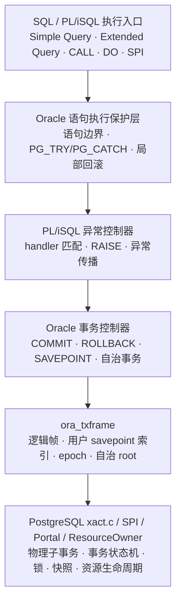
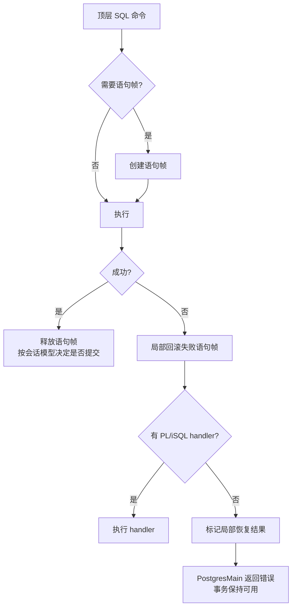
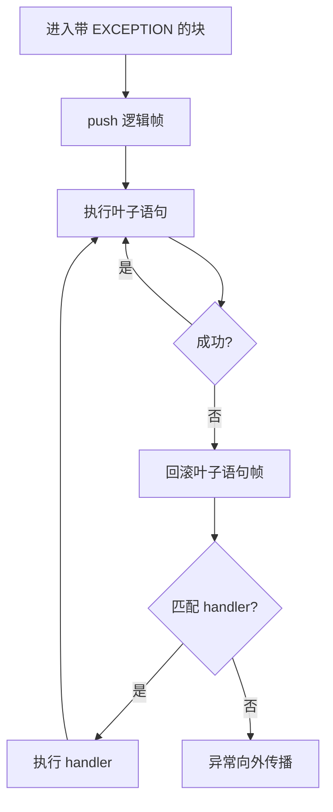
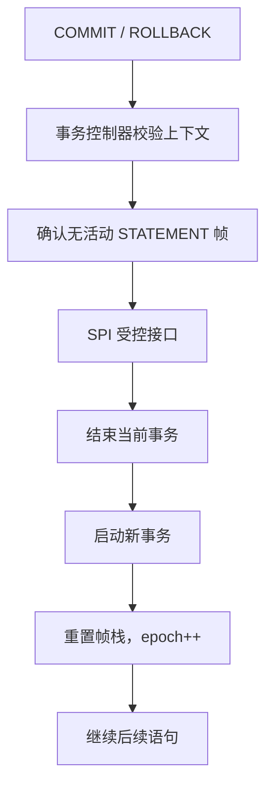
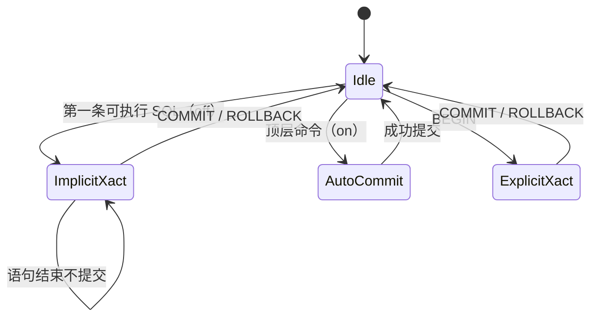
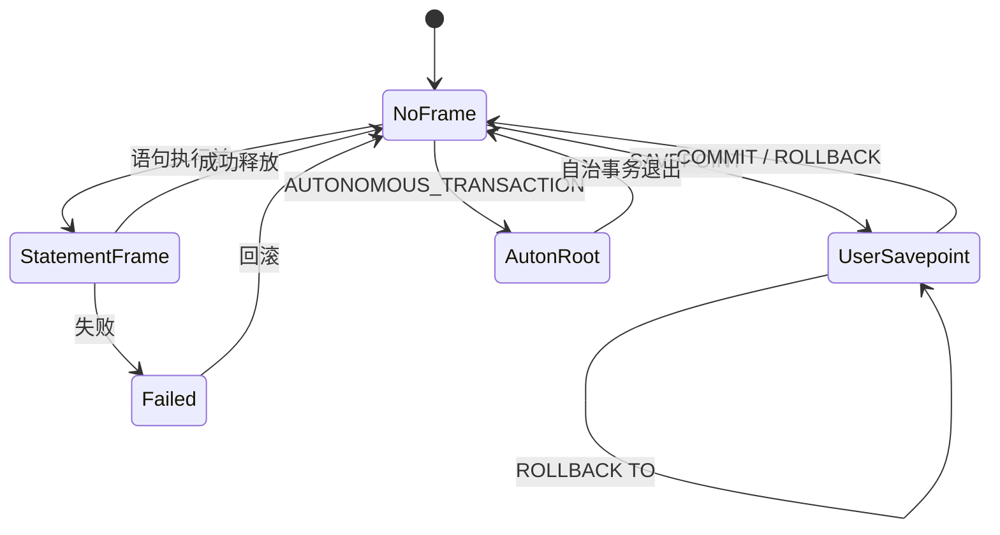

# Oracle 事务兼容概要设计

- 文档版本：1.0
- 日期：2026-11-12
- 状态：设计基线
- 适用版本：PG14 二次开发版本
- 相关文档：
  - `doc/oracle_transaction/oracle_transaction_requirements.md`
  - `doc/oracle_transaction/oracle_transaction_detailed_design.md`
  - `doc/oracle_transaction/oracle_transaction_test_spec.md`
  - `doc/oracle_transaction/oracle_transaction_compat_plan.md`（设计演进记录）

---

## 1. 设计目标

本设计只针对 Oracle 兼容模式，目标是实现以下核心语义：

> 未处理异常回滚失败的顶层 SQL 语句（匿名块或过程调用）的整个 DML；事务中之前成功的 SQL 语句保留；事务保持可用。
> 异常被 `EXCEPTION` handler 捕获时，只回滚失败的内层 SQL 语句，块内之前成功的语句保留。

设计需要满足：

1. 不影响 PG 模式和 MySQL 模式；
2. 物理事务状态仍由 PostgreSQL `xact.c` 管理；
3. SQL 与 PL/iSQL 共享同一事务作用域；
4. 支持 Extended Query Protocol；
5. 支持自治事务；
6. 可测试、可回退、可分阶段落地。

---

## 2. 设计原则

1. **SQL 语句失败，只能由对应语句执行边界负责回滚。**
2. **PL/iSQL 异常传播不等于事务回滚。**
3. **`ora_txframe` 只管理逻辑帧，不管理物理事务。**
4. **PostgreSQL `xact.c` / SPI / ResourceOwner 是物理状态权威。**
5. **所有物理子事务操作必须通过统一包装接口同步逻辑帧。**
6. **`PostgresMain` 只处理未被局部边界恢复的错误和协议恢复。**
7. **新旧自动 savepoint 机制必须互斥。**

---

## 3. 总体架构



### 3.1 分层职责

| 层 | 职责 |
|---|---|
| 执行入口 | 接收 SQL、Extended Query、CALL、DO、SPI 调用 |
| 语句执行保护层 | 创建/释放/回滚语句帧，捕获局部错误 |
| PL/iSQL 异常控制器 | 匹配 handler，执行 handler，控制异常传播 |
| Oracle 事务控制器 | 处理 COMMIT / ROLLBACK / SAVEPOINT / 自治事务 |
| `ora_txframe` | 维护逻辑帧、用户 savepoint、epoch、自治 root |
| PG 事务层 | 维护物理子事务、事务状态机、锁、快照、资源生命周期 |

---

## 4. 模块划分

### 4.1 新增模块 `ora_txframe`

职责：

- 逻辑事务帧栈；
- 用户 savepoint 查找；
- 内部语句帧；
- 异常块逻辑帧；
- 自治事务 root；
- transaction epoch；
- 错误恢复状态。

不负责：

- 物理子事务提交/回滚；
- ResourceOwner / MemoryContext 生命周期；
- 锁和快照；
- Portal 生命周期。

### 4.2 `xact.c`

职责：

- 在事务、子事务、自治事务生命周期中挂接帧回调；
- 提供事务状态机；
- 维护 epoch；
- 处理旧自动 savepoint 与新模型的互斥。

### 4.3 `postgres.c`

职责：

- 顶层 SQL 语句保护边界；
- Extended Query Portal 边界；
- 自动提交与显式事务状态；
- 顶层错误恢复 fallback；
- `ReadyForQuery` 状态。

### 4.4 `pl_exec.c`

职责：

- 去掉异常块级子事务；
- 为叶子 SQL 语句建立语句帧；
- 异常 handler 匹配和传播；
- PL/iSQL 事务控制语句执行；
- `FORALL` 防重复建帧；
- 游标相关行为。

### 4.5 `spi.c`

职责：

- 提供内部受控事务控制接口；
- 复用现有 `_SPI_commit` / `_SPI_rollback` 的资源处理；
- 不提供通用“绕过子事务检查”的公共 API。

### 4.6 `utility.c`

职责：

- Oracle 模式下 `CALL` / `DO` 的 atomic context 判定；
- 保留函数、触发器、package、SECURITY DEFINER 的现有规则。

### 4.7 GUC

新增：

- `ivorysql.ora_autocommit`：默认 `true`，仅 Oracle 模式生效。

---

## 5. 关键设计决策

### 5.1 会话事务模型

| 配置 | 行为 |
|---|---|
| `ora_autocommit=on`（默认） | 模拟客户端 autocommit，顶层命令成功结束提交 |
| `ora_autocommit=off` | IvorySQL Oracle 模式持续事务兼容策略 |
| 显式 `BEGIN` | 覆盖自动提交，直到 `COMMIT` / `ROLLBACK` |

说明：

- `off` 不是 Oracle 数据库原生默认行为；
- 普通 `SELECT` 也作为事务执行单元；
- 失败命令不触发自动提交；
- 之前成功的内部工作可能保留在当前事务中。

### 5.2 语句级帧替代异常块级子事务

- 删除 PL/iSQL 异常块入口的 `BeginInternalSubTransaction()`；
- 异常块只保留逻辑帧；
- 顶层 SQL 语句（包括匿名块、`CALL` / `DO`）建立顶层语句帧；
- 异常被 handler 捕获时，失败的内层 SQL 语句只回滚自己；
- handler 捕获后，块内之前成功的语句保留；
- 未处理异常向上传播时，回滚整个顶层语句帧，事务中之前成功的 SQL 语句保留；
- `CALL` / 嵌套块本身不单独建帧；帧加在其内部实际 SQL 语句上，handler 捕获时只回滚失败的内层 SQL 语句。

### 5.3 用户 savepoint 与内部帧分离

- 用户 savepoint 是事务作用域；
- SQL 与 PL/iSQL 共享命名空间；
- 内部语句帧对用户不可见；
- `OraTxFrameFindUserSavepoint(name)` 只查找用户帧；
- 自治事务与主事务 savepoint 隔离。

### 5.4 错误恢复边界

| 边界 | 职责 |
|---|---|
| 顶层 SQL 语句 | 创建/释放/回滚顶层语句帧 |
| PL/iSQL 叶子语句 | 创建/释放/回滚叶子语句帧 |
| 异常块 handler | 匹配 handler，执行 handler |
| `PostgresMain` | fallback、协议恢复、错误返回 |

原则：

- 局部边界先恢复；
- `PostgresMain` 不猜测应该回滚哪条 SQL；
- 未处理异常回滚当前顶层语句帧，保留事务中之前成功的 SQL 语句；
- handler 捕获异常时，只回滚失败的内层 SQL 语句；
- 纯 PL/iSQL 异常没有内层语句帧时，不影响事务中之前成功的 SQL 语句。

### 5.5 Extended Query Portal

两类语句帧：

| 类型 | 场景 | 生命周期 |
|---|---|---|
| PortalFrame | DML RETURNING、`SELECT FOR UPDATE`、含 DML 的 MULTI_QUERY | Portal 完整生命周期 |
| Per-Execute 帧 | 只读 SELECT | 每次 Execute |

交错限制：

- 同时只允许一个活动 PortalFrame Portal；
- 两个 PortalFrame Portal 交错执行时明确报错；
- 只读 Per-Execute 短帧可以嵌套在 PortalFrame 下。

### 5.6 MULTI_QUERY 逐语句帧

- `PORTAL_MULTI_QUERY` 不使用一个覆盖整个 Portal 的帧；
- 内部每个实际 SQL 执行单元建立独立语句帧；
- 失败语句回滚自己；
- 之前成功语句保留；
- 后续语句停止。

### 5.7 新旧 savepoint 互斥

| 模式 | 旧自动 savepoint | 新事务帧 |
|---|---|---|
| PG | 保持 | 不启用 |
| MySQL | 保持 | 不启用 |
| ORA 旧模式 | 按旧 GUC | 不启用 |
| ORA 新模式 | 禁用 | 启用 |

### 5.8 自治事务

- 独立事务边界；
- 独立帧栈 root；
- 内部复用语句级帧模型；
- 提交/回滚只影响自治事务；
- savepoint 与主事务隔离；
- 退出未显式提交时保持宽松自动提交策略。

---

### 5.9 语句级回滚开关

`ivorysql.ora_statement_level_rollback` 控制是否启用新的语句级帧模型：

| 配置 | 顶层 SQL 失败 | PL/iSQL handler 捕获 | 未处理异常 |
|---|---|---|---|
| `off`（默认） | 事务 aborted | 异常块整块回滚 | 事务级回滚 |
| `on` | 只回滚失败语句 | 只回滚失败内层语句 | 回滚失败顶层语句 |

说明：

- 默认 `off`，保持现有 PostgreSQL / Kingbase 风格行为；
- `on` 时才启用 v2.3 定义的顶层语句帧、叶子语句帧和严格 Oracle 未处理异常语义；
- `ora_autocommit` 与 `ora_statement_level_rollback` 相互独立；
- 严格 Oracle 事务语义需要显式设置 `ora_statement_level_rollback=on`。

## 6. 核心流程

### 6.1 顶层 SQL 执行与错误恢复



### 6.2 PL/iSQL 异常处理



### 6.3 COMMIT / ROLLBACK



---

## 7. 状态模型

### 7.1 事务状态



### 7.2 帧状态



---

## 8. 对外接口概览

### 8.1 `ora_txframe` API

```c
void ora_txframe_init(void);
void ora_txframe_reset_top(void);
void ora_txframe_begin_auton(void);
void ora_txframe_end_auton(bool isCommit);

void ora_txframe_begin_statement(void);
void ora_txframe_end_statement_success(void);
void ora_txframe_end_statement_error(void);

void ora_txframe_define_user_savepoint(const char *name);
void ora_txframe_rollback_to_user_savepoint(const char *name);

OraTxFrame *ora_txframe_current(void);
OraTxFrame *ora_txframe_find_user_savepoint(const char *name);
bool ora_txframe_is_valid(const OraTxFrame *frame);
bool ora_txframe_has_active_handler(void);
uint64 ora_txframe_epoch(void);
```

### 8.2 错误恢复 API

```c
void OraErrorStateReset(void);
void OraErrorMarkStatement(SubTransactionId subid, uint64 epoch);
void OraErrorMarkRuntime(void);
void OraErrorMarkRecovered(void);
bool OraErrorIsRecovered(void);
bool OraErrorConsumeRecovered(void);
OraErrorOrigin OraErrorGetOrigin(void);
```

### 8.3 事务控制 API

```c
int OraExecCommit(PLiSQL_execstate *estate, bool chain);
int OraExecRollback(PLiSQL_execstate *estate, bool chain);
int OraExecSavepoint(PLiSQL_execstate *estate, const char *name);
int OraExecRollbackTo(PLiSQL_execstate *estate, const char *name);
```

### 8.4 SPI 内部接口

```c
int SPI_ora_commit(bool chain);
int SPI_ora_rollback(bool chain);
int SPI_ora_savepoint(const char *name);
int SPI_ora_rollback_to(const char *name);
```

这些接口仅供 Oracle 事务控制器调用，不作为通用公共能力。

---

## 9. 兼容性行为摘要

| 场景 | 行为 |
|---|---|
| `on` + 单条成功 DML | 命令结束提交 |
| `on` + 显式 `BEGIN` | 暂停自动提交 |
| `off` + 单条 DML | 事务保持打开 |
| 显式事务中失败 DML（开关 on） | 只回滚失败语句 |
| 显式事务中失败 DML（开关 off，默认） | 整个事务 aborted |
| `SELECT 1/0` | 只回滚当前语句，事务可用 |
| PL/iSQL 异常块失败（handler 捕获，开关 on） | 只回滚失败的内层语句 |
| PL/iSQL 异常块失败（开关 off，默认） | 整块回滚 |
| 纯 `RAISE` 未处理（开关 on） | 回滚当前顶层块/调用，事务中之前 SQL 保留 |
| 纯 `RAISE` 未处理（开关 off，默认） | 事务级回滚 |
| 异常块内 `COMMIT` | 允许 |
| 用户 `SAVEPOINT` | 与内部帧隔离 |
| 自治事务 | 独立事务边界 |
| 两个 PortalFrame 交错 | 明确报错 |
| MULTI_QUERY | 逐语句帧 |
| DDL 隐式提交 | 本期不实现 |
| `FORALL SAVE EXCEPTIONS` | 本期不实现 |

---

## 10. 风险与缓解

| 风险 | 缓解 |
|---|---|
| 顶层错误恢复影响面大 | 局部边界负责回滚，`PostgresMain` 只做 fallback |
| Portal 生命周期复杂 | 两类帧、交错限制、专项 TAP 测试 |
| SPI 事务控制冲突 | 复用现有 SPI 资源处理，不提供通用绕过接口 |
| 新旧 savepoint 双重回滚 | 明确互斥，新模式禁用旧机制 |
| 子事务开销 | 只对需要语句级恢复的语句建帧 |
| 测试基线含 PG 语义 | 阶段 0 拆分为 Oracle / PG 两组基线 |

---

## 11. 实施阶段

| 阶段 | 内容 |
|---|---|
| 0 | 行为规范与测试基线 |
| 1 | 错误状态 generation + 帧栈骨架 |
| 2 | 顶层 SQL 语句帧 + Simple Query 多语句限制 |
| 3 | Extended Query Portal 语句帧 |
| 4 | PL/iSQL 叶子语句帧 + 异常传播 |
| 5 | 事务控制器 + SPI 受控接口 |
| 6 | `SAVEPOINT` / `ROLLBACK TO` |
| 7 | `CALL` / `DO` + atomic 矩阵 |
| 8 | 自治事务 |
| 9 | `ora_autocommit` / 隐式事务 |
| 10 | 回归、游标、Portal、性能 |

---

## 12. 文档关系

- 需求：`doc/oracle_transaction/oracle_transaction_requirements.md`
- 概要设计：本文档
- 详细设计：`doc/oracle_transaction/oracle_transaction_detailed_design.md`
- 测试规范：`doc/oracle_transaction/oracle_transaction_test_spec.md`
- 设计演进记录：`doc/oracle_transaction/oracle_transaction_compat_plan.md`